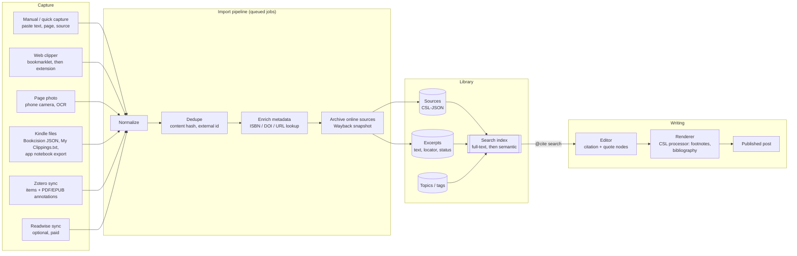
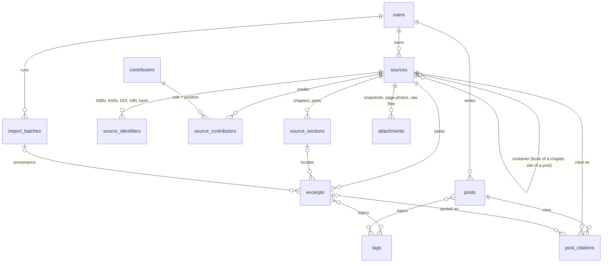
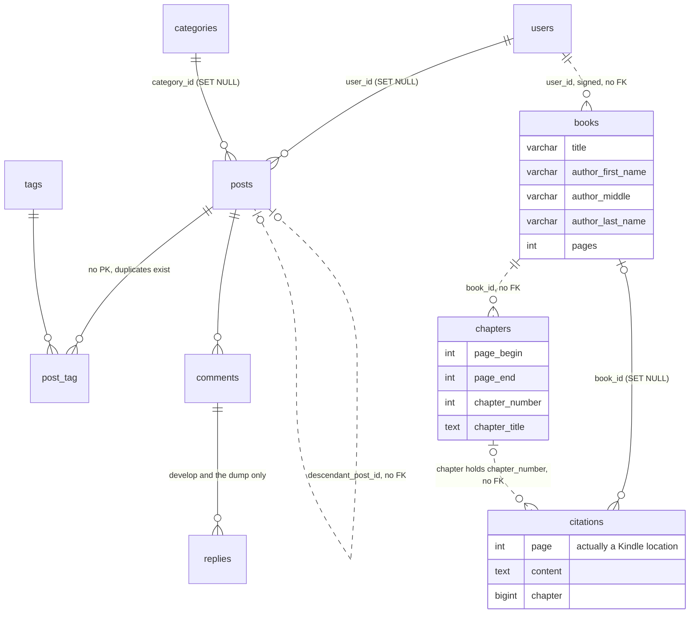

# Athenaeum: project review, the Kindle problem, and a proposed path forward

*Prepared 2026-10-24 against branch `establishUnitTests` at commit `d497937` (plus two uncommitted files). This was a read-only review: no application code, tests, package tooling, or migrations were run, and nothing in the repository was changed apart from adding this file.*

## Contents

1. [Summary](#1-summary)
2. [How this review was done](#2-how-this-review-was-done)
3. [The project today](#3-the-project-today)
4. [Defects and limitations](#4-defects-and-limitations)
5. [Kindle: why the import plan stalled](#5-kindle-why-the-import-plan-stalled)
6. [Rethinking the goal](#6-rethinking-the-goal)
7. [Proposed implementation](#7-proposed-implementation)
8. [Build plan](#8-build-plan)
9. [Thoughts on the project](#9-thoughts-on-the-project)
10. [Appendices](#10-appendices)

---

## 1. Summary

**What the project is.** A 2022 Laravel 8 + React 17 blog with a private library of Kindle highlights imported from Bookcision, about 8,000 lines in all. The only data worth keeping is 3 books and their 1,217 highlights. The checked-out branch is **65 commits behind `develop`**, and `develop` is the branch your database actually matches (§3).

**Where it stands.** It works as a demo, but it is not safe to deploy, and in places it doesn't work:
- **Security** (§4):
  - The post-update endpoint performs a server-side file read and write, which is critical.
  - Post content is rendered unsanitized, so stored XSS is possible.
  - The API authenticates almost nothing; the chapter and citation endpoints are fully public.
  - There are no ownership checks.
- **Citations:** a "citation" is pasted text, and the page it shows is really a Kindle location.
- **Platform:** Laravel 8 has had no security fixes since January 2023. The lockfile only installs on PHP 8.2, whose security support ends in December 2026. The frontend can't build as checked out.

**Why the Kindle plan stalled.** Not because of your code. Kindle's limits are structural (§5):
- Publishers cap exports at roughly **10–20% of a book**, on every route including Readwise.
- Exports carry **locations, which APA, MLA, and Chicago all advise against citing**.
- There is no API, and scraping is against Amazon's terms.
- The export routes keep shrinking. Bookcision itself was broken for six weeks last winter.

**The fix is a new foundation, not a better importer.** Model *evidence*: sources stored as CSL-JSON, excerpts with typed locators and a verification status, and structured citations inside posts. Kindle becomes one optional input that produces *leads to verify*, alongside print books captured with your phone's OCR, the web, PDFs, and Zotero (§6–7).

**Recommended course of action** (§8):
1. **Rebuild** on Laravel 13's official React starter kit with PostgreSQL rather than upgrading in place. Port the ideas and the 1,217 highlights, not the code.
2. **Phase 1, library:** quick capture (your phone's OCR plus the printed page number), ISBN, DOI, and URL lookup, and full-text search. Migrate the old highlights as *unverified*.
3. **Phase 2, writing:** a TipTap editor with citation nodes, with footnotes and a bibliography rendered from CSL in APA, MLA, or Chicago.
4. **Phases 3–4, capture breadth:** Kindle importers feeding a verification queue, a web clipper with archiving, and Zotero sync (Readwise too, if you subscribe).
5. **Phase 5, optional:** semantic "find support" search and AI assists that only rank or transcribe material already in your library, never invent it.

---

## 2. How this review was done

Six agents ran in parallel, each with a narrow brief, and their reports were merged and spot-checked against the code for this document:

| Agent | Scope |
|---|---|
| Backend | `app/`, `routes/`, `config/`, `tests/`, the uncommitted diff, git history |
| Frontend | `resources/js/**`, Blade shell, Sass/CSS, Mix config |
| Database | Migrations, models, factories, seeders, and the two MySQL dumps in `dbBackups/` (aggregate shape only) |
| Libraries | `composer.json`/`.lock`, `package.json`/`-lock.json`, installed versions, current status of each package (web research) |
| Kindle research | How Kindle highlights can be exported as of October 2026, the limits on each path, and the alternatives (web research) |
| Citation tooling research | Metadata formats, citation formatters, lookup APIs, web capture, annotation integrations, search, and editors (web research) |

Ground rules for every agent: read only, run nothing (no `php`, `artisan`, `composer`, `npm`, or tests), and never copy secrets or personal data from `.env` or the SQL dumps into a report. Claims about third-party services carry a source URL ([Appendix D](#appendix-d-sources)). Where a claim couldn't be confirmed it is marked as uncertain.

Some facts in this document change often, such as Kindle behaviour, package versions, and API pricing. They are correct as of the date above and should be rechecked before any build starts.

---

## 3. The project today

### 3.1 What it is

Athenaeum is a multi-user blog with a private library of book highlights. It is a Laravel 8 JSON API, with JWT login and Spatie roles (`superadmin`, `admin`, `author`), serving a React 17 single-page app built with Laravel Mix. The project has carried four names: the repository is *athenaeum*, the database *journeyman*, the page title *Tasksman* ([app.blade.php:9](resources/views/app.blade.php#L9)), and the header *Phronesis Project* ([Header.js:291](resources/js/components/Header.js#L291)).

Features as built:

- **Public:** a home page of recent posts with a tag filter, an author search, per-author blogs, and a post page with comments.
- **Writing:** title, tags, a publish toggle, a header image, and a Quill editor. Posts can be chained into a series (a linked list of posts).
- **Library:** upload a Bookcision JSON export or add a book by hand. Add chapters with page ranges and auto-assign highlights to them. Insert a highlight at the cursor in the editor.
- **Admin:** tag, category, and user management. Some of these screens call endpoints that aren't routed on this branch.

### 3.2 History, and which branch matters

- Most of the work happened between January and April 2022 (98 of 140 commits are from March 2022).
- `develop` split from `master` on 2022-03-15 (`1f3a2e3`) and continued until 2022-07-30. It has **65 commits the checked-out branch lacks**: comment and reply controllers, a `users.active` flag, the removal of `is_admin`, post-series creation, and chapter auto-assignment on save.
- `establishUnitTests`, the current branch, is `master` plus 11 commits, mostly the July 2023 tests.
- **The April 2022 database dump matches `develop`, not this branch**: it has the `replies` table and `develop`'s extra migrations. Running a fresh migrate from this branch can't reproduce your real database. Any work on the old code should start from `develop`.

### 3.3 Size and data

- About 5,350 lines of React across 40 files, about 1,400 lines of PHP in controllers and models, 18 migrations, and 12 tests.
- **The only data worth keeping:** 3 Kindle books and their 1,217 highlights, in `dbBackups/jm04042022.sql`. Every other row in both dumps is seed or test data.
- About 630 highlight ids are missing from the sequence, so some imports were apparently deleted and redone. No post contains an inserted citation.
- `.env` and `dbBackups/` are git-ignored and absent from all history, which is good. The dumps contain user rows, so keep them out of anything you share.

### 3.4 What works and what doesn't (on this branch)

| Area | Status | Detail |
|---|---|---|
| Login | Works | JWT returned with the user's permission list and stored in `localStorage`; 60-minute lifetime; the SPA never refreshes it |
| Registration | **Broken** | Saves the username into `is_admin` and omits the NOT NULL first and last names ([JWTController.php:42-48](app/Http/Controllers/JWTController.php#L42-L48)) |
| Home page "recent posts" | Works, wrong order | Sorts ascending, so it shows the **oldest** 10 ([PostController.php:73-76](app/Http/Controllers/PostController.php#L73-L76)) |
| Post page | **Breaks** on posts with comments | Eager-loads `comments.replies`, a relation that exists only on `develop` ([PostController.php:192](app/Http/Controllers/PostController.php#L192)) |
| Writing a post | Partly works | Saved with `quill.getText()`, so all formatting is lost ([NewPost.js:306](resources/js/components/Posts/NewPost.js#L306)). After **Create** the app navigates to `/post/edit/undefined` |
| Header image | Partly works, unsafe | Stored as a base64 string in a LONGBLOB and saved only on update, through an unsafe file write (see §4) |
| Bookcision import | Works, but lossy | Keeps the title, highlight text, and Kindle location. Drops authors, ASIN, notes, and the note-only flag |
| Chapters and auto-assign | Fragile | Compares page ranges against Kindle locations. Only 83 of one book's 241 highlights were ever assigned |
| Citing in a post | Works, as plain text | Pastes `"quote", Title, Page: N` at the cursor, with no link back to the highlight ([NewPost.js:224-243](resources/js/components/Posts/NewPost.js#L224-L243)) |
| Comments, categories, user edit | Not working on this branch | The frontend calls `/api/comments`, `/api/categories`, `/api/users`, and `/api/replies`, none of which are routed here |
| Tests | Can't run in isolation | They run against your development MySQL database and need seeded data, so they can't run in CI as written |

### 3.5 Capabilities in detail

The table in §3.4 gives each feature's status. This section describes what each layer *can do* today, and what is worth keeping from it.

**Backend (Laravel API)**

| Ability | How it works | Worth keeping? |
|---|---|---|
| Login with a permission-aware response | `auth()->attempt()` on the `jwt` guard returns the token plus the user, a flat list of permission names, and `isSuperAdmin`. The SPA can then gate its UI without extra calls. TTL 60 minutes, 14-day refresh window, blacklist on ([JWTController.php:118-146](app/Http/Controllers/JWTController.php#L118-L146), `config/jwt.php`) | The *shape*, yes: a `/me` payload with permissions. JWT, no |
| Role-based access | Spatie v5 with three seeded roles: `superadmin` (bypasses checks), `admin` (all 25 permissions), and `author` (post-*, book-list, comment-*). The `perm.auth:<perm>` middleware passes a user who holds any listed permission or is superadmin ([PermissionAuthorization.php:21-49](app/Http/Middleware/PermissionAuthorization.php#L21-L49), [PermissionsSeeder.php](database/seeders/PermissionsSeeder.php)) | The role design, yes, if you stay multi-author. The middleware, no: replace it with Policies, and return 403 rather than 401 on denial |
| Posts | Create and update (title, content, published flag, tag sync through `post_tag`, slug through `Str::slug`) and delete ([PostController.php:155-268](app/Http/Controllers/PostController.php#L155-L268)) | The concept |
| Post series | A post links to its next post (`descendant_post_id`), and `getPostAndDecendants` walks the chain recursively and returns it in id order ([PostController.php:82-147](app/Http/Controllers/PostController.php#L82-L147)) | The idea. Use `parent_id` + `position` instead of a linked list |
| Public browsing | Recent posts with an optional tag filter (`whereHas('tags')`) and author filter; per-author blogs; author list; post detail with comments ([PostController.php:44-80](app/Http/Controllers/PostController.php#L44-L80), [UserController.php](app/Http/Controllers/UserController.php)) | Yes, as features |
| Tags | index, store, update, and destroy, plus a tag → posts listing ([TagController.php](app/Http/Controllers/TagController.php)) | Yes, extended to excerpts and sources as topics |
| Bookcision import | One request creates the book and bulk-inserts every highlight in a single `Citation::insert` ([BookController.php:42-79](app/Http/Controllers/BookController.php#L42-L79)) | The knowledge of the format; re-implemented as an `Importer` |
| Manual library entry | Create books (title, one author, page count), citations (book, page, text, chapter), and chapters (number, title, range) ([BookController.php](app/Http/Controllers/BookController.php), [CitationController.php](app/Http/Controllers/CitationController.php), [ChapterController.php](app/Http/Controllers/ChapterController.php)) | The workflow, yes |
| Chapter auto-assignment | Assigns each citation to the chapter whose `page_begin`–`page_end` range contains its value ([Citation.php:25-47](app/Models/Citation.php#L25-L47)) | The idea, as `source_sections` with ranges in the same unit |
| Title search | `LIKE` search on book titles, returning books with their citations ([BookController.php:92-99](app/Http/Controllers/BookController.php#L92-L99)) | Superseded by full-text search |
| Book deletion | Deletes the chapters, then the citations, then the book ([BookController.php:119-129](app/Http/Controllers/BookController.php#L119-L129)) | Superseded by foreign-key cascades or soft deletes |
| Tests | 12 feature tests: registration validation, login for each role, user posts, the series chain, post detail, citation creation, and name accessors ([tests/Feature](tests/Feature)) | As a checklist of behaviours to re-test |

**Frontend (React SPA)**

| Ability | How it works | Worth keeping? |
|---|---|---|
| Routing with permission gates | React Router 6 routes, each wrapped in `ProtectedRoute` with a required permission. Superadmin passes everything ([App.js:76-160](resources/js/components/App.js#L76-L160), [ProtectedRoute.js](resources/js/components/ProtectedRoute.js)) | The map of public vs. gated pages. Real enforcement belongs on the server |
| Persistent session | Auth state in React Context, mirrored to `localStorage`. The token's expiry is checked on load and expired sessions are cleared ([GlobalStates.js](resources/js/components/GlobalStates.js)) | No; replaced by session auth |
| Public reading | Home page of recent posts with tag chips, author search in the header, per-author blog pages, and a post page with comment and reply UI ([RecentBlog.js](resources/js/components/Home/RecentBlog.js), [Header.js](resources/js/components/Header.js), [UserBlog.js](resources/js/components/Users/UserBlog.js), [ShowPost.js](resources/js/components/Posts/ShowPost.js)) | As page designs |
| Dashboard | Lists the user's posts, with edit, delete, and "add to series" controls shown according to permissions, plus a tag search ([Dashboard.js](resources/js/components/Home/Dashboard.js)) | As a page design |
| Editor | Title, slug, tags, publish toggle, header image with preview, and a Quill toolbar (headings, lists, links, images, video, colours). The source panel lets you pick a book and chapter and click a highlight to insert it at the cursor ([NewPost.js](resources/js/components/Posts/NewPost.js), [BookCitationList.js](resources/js/components/Posts/BookCitationList.js)) | **The side-panel, click-to-insert interaction is the best UX idea in the codebase.** Keep it, backed by structured citation nodes |
| Library page | Lists your books with their highlights. Drag-and-drop Bookcision upload, manual book entry, chapter entry with ranges, "process citations into chapters", and delete ([UserBookList.js](resources/js/components/Users/UserBookList.js), [Books/](resources/js/components/Books)) | As the starting point for the library and verification-queue screens |
| Tag administration | Collapsible table of tags with their posts, plus create, edit, and delete modals ([TagsList.js](resources/js/components/Tags/TagsList.js)) | As a page design |

**Database**

| Ability | Worth keeping? |
|---|---|
| utf8mb4 everywhere. This matters: 63% of the real highlights contain curly quotes or dashes | Yes (PostgreSQL is UTF-8 by default) |
| Enforced foreign keys with sensible cascades on posts → users and categories (SET NULL), comments, replies, and `post_tag` (CASCADE), and citations → books (SET NULL) | The pattern, applied to every relationship |
| Spatie permission tables, seeded with roles and permissions | If multi-author |
| Factories and seeders for every domain model (users, posts, tags, categories, books, chapters, citations) | As a pattern. They need to be self-contained (§4) |
| A hierarchy of book → chapter → citation | Yes, generalized to source → section → excerpt |

**Libraries.** Quill provides rich-text editing, though its output is discarded on save (§4). MUI v4 supplies lists, modals, autocomplete, and tables. SweetAlert2 handles confirmations, react-files provides the drag-and-drop upload, and react-lines-ellipsis truncates excerpts. The starter kit's shadcn/ui and TipTap cover all of these, which is why §7.10 removes them.

### 3.6 Platform and libraries

| Layer | In the project | Status, October 2026 |
|---|---|---|
| PHP | `^7.3\|^8.0` declared, but the lockfile resolves **only on PHP 8.2.x** (`lcobucci/clock 3.1.0` requires `~8.2.0`) | PHP 8.2 security support ends **2026-12-31** |
| Laravel | 8.83.27 | Out of security support since **2023-01-24**. Current is **Laravel 13** (released 2026-03-17; PHP 8.3–8.5; security fixes until 2028-03-17) |
| MySQL | 8.0.13 (from the dump headers) | The 8.0 series reached end of life in April 2026; 8.4 LTS is current |
| Auth | `tymon/jwt-auth` locked to the moving `dev-develop` branch, which only resolves because `"minimum-stability": "dev"` | The package is maintained again (2.3.x supports Laravel 13), but Laravel recommends session auth for a first-party SPA. Sanctum is installed and unused |
| Build | Laravel Mix 6 | Effectively retired (last release June 2022). Laravel uses Vite |
| UI | MUI **v4** (`@material-ui/core` 4.12.3) in 25 files, but **not declared** in `package.json`; it is present only as a peer dependency. The declared MUI v5, emotion, and material-table are never imported | MUI v4 has had no development since 2021. The current MUI major is 9 |
| Editor | `react-quilljs` → Quill 1.3.7 | Quill's last release was 2.0.3 (November 2024), and it has an unpatched advisory |
| Install state | `quill-image-uploader` is imported in two files but **absent from `node_modules`** | The frontend can't build as checked out |

Locked versions with known advisories include `laravel/framework` 8.83.27 (no further 8.x fixes), `symfony/http-foundation` 5.4.25 (CVE-2025-64500, High), axios 0.21.4 (CVE-2023-45857, CVE-2025-27152), lodash 4.17.21, ag-grid 27 (CVE-2024-38996), and Quill 1.3.7. Most of these disappear with a fresh skeleton. [Appendix C](#appendix-c-dependencies) has the full table.

---

## 4. Defects and limitations

The defects cluster in three places, and those are the places the citation goal depends on most:

1. **The trust boundary.** The server takes user ids, ownership, and file paths from the browser.
2. **The content model.** Posts are plain text, and citations are pasted strings.
3. **The source model.** There are only books, with one author each, and a Kindle location stands in for a page.

That is why §7 rebuilds these layers rather than patching them. The defects most worth knowing about follow; the agents' full lists had about 50 items.

### Security

| Sev. | Defect | Where |
|---|---|---|
| Critical | **Server-side file read and write on post update.** `file_get_contents()` runs on a string from the browser, which allows fetching URLs or local files such as `.env`. The result is written to `public/post_images/<title>`, where a crafted title can escape the folder. Anyone with `post-edit` (every author) can trigger it | [PostController.php:228-232](app/Http/Controllers/PostController.php#L228-L232) |
| High | **Stored XSS.** Post content is rendered as raw HTML in five places, including the public home page, and nothing sanitizes it on input or output. The JWT sits in `localStorage`, so an injected script can take over an account | [ShowPost.js:156](resources/js/components/Posts/ShowPost.js#L156), [RecentBlog.js:100](resources/js/components/Home/RecentBlog.js#L100), and 3 more |
| High | **The `api` middleware group doesn't authenticate anyone.** It contains only throttling and route binding. The chapter and citation endpoints have no guard at all, so anyone can read every user's highlights (`GET /api/citations`, `books/searchByTitle?bookTitle=%`) or write to them | [Kernel.php:42-46](app/Http/Kernel.php#L42-L46), [ChapterController.php](app/Http/Controllers/ChapterController.php), [CitationController.php](app/Http/Controllers/CitationController.php) |
| High | **No ownership checks.** Any author can edit, delete, or reassign anyone's post, and user ids come from the request body or query string | [PostController.php:222-268](app/Http/Controllers/PostController.php#L222-L268), [BookController.php:31,50](app/Http/Controllers/BookController.php#L31) |
| High | **Drafts are public.** Post detail, user posts, and the author list return unpublished posts and user emails | [PostController.php:190-202](app/Http/Controllers/PostController.php#L190-L202), [User.php:35-37](app/Models/User.php#L35-L37) |
| High (`develop`) | **Anyone can make themselves an admin.** New users get `author`, which on `develop` includes `user-edit`, so they can PATCH their own role. A public `/api/ping` route calls Mailchimp and dumps the response | `develop` branch |

### Data and citation integrity

| Sev. | Defect | Where |
|---|---|---|
| High | **Kindle locations are stored and shown as page numbers.** Values reach 5,743 in books recorded as 500 pages, and every quote pasted into a post says "Page: N" | [BookController.php:70](app/Http/Controllers/BookController.php#L70), [BookCitationList.js:54](resources/js/components/Posts/BookCitationList.js#L54) |
| High | **The importer is lossy.** It ignores `authors`, `asin`, `note`, and `isNoteOnly`, so your own notes are imported as quotations from the author. There is no validation, transaction, or dedupe, so re-importing duplicates everything | [BookController.php:42-79](app/Http/Controllers/BookController.php#L42-L79) |
| High | **A quote can be credited to the wrong book.** After you switch books, the editor's panel keeps the previous book's highlights but shows the new title | [NewPost.js:262-269](resources/js/components/Posts/NewPost.js#L262-L269), [BookCitationList.js:50-52](resources/js/components/Posts/BookCitationList.js#L50-L52) |
| High | **Cancel still deletes.** The delete dialogs check `if (willDelete)`, but SweetAlert2 resolves with an object, which is always truthy. Cancelling a book deletion still deletes the book with all its highlights and chapters | [Dashboard.js:142-168](resources/js/components/Home/Dashboard.js#L142-L168), [UserBookList.js:131-161](resources/js/components/Users/UserBookList.js#L131-L161) |
| High | **Posts aren't linked to what they cite.** `Post::books()` points at a `book_post` table that no migration creates. No branch has footnotes, a bibliography, or source metadata | [Post.php:79-82](app/Models/Post.php#L79-L82) |
| Medium | **Chapter assignment is unreliable.** It compares mixed units, stores the chapter *number* (which isn't unique) instead of the id, lets the last overlapping match win, and never clears stale assignments | [Citation.php:25-47](app/Models/Citation.php#L25-L47) |
| Medium | **Integrity constraints are missing.** Several relationship columns have no foreign key, and some are signed while the ids they point at aren't. `post_tag` has no primary key and already holds duplicate rows. Tags and slugs aren't unique. Two relations use the wrong keys | migrations, [Tag.php:15](app/Models/Tag.php#L15), [Book.php:42](app/Models/Book.php#L42) |
| Medium | **Excerpts can break JSON responses.** They are truncated with byte-based `substr`, which can split a multibyte character, and 63% of the real highlights contain curly quotes or dashes. A bad split makes the response fail | [Post.php:92](app/Models/Post.php#L92) |

### Maintainability

- **Unsupported platform.** Laravel 8 stopped receiving security fixes in January 2023, and `tymon/jwt-auth` is locked to a `dev-develop` snapshot. Details in §3.6.
- **UI library sprawl.** The code imports MUI v4, which isn't declared in `package.json`. The declared MUI v5, emotion, material-table, and react-jwt are never imported. ag-grid, lodash, and Bootstrap's JS are bundled but unused: about 45% of the 7.35 MB development bundle.
- **No shared API client.** There are 28 hand-built `Authorization` headers using three different token keys. There is no 401 handling, and an expired session can't log out.
- **Inconsistent responses.** JSON is sometimes returned as `text/html` strings, not-found returns a 400, and some endpoints answer with a 302 redirect.
- **Dead code.** Example and tutorial components, unrouted controllers, a JWT middleware nothing uses, and Sanctum installed but switched off.
- **Accessibility and layout.** There are no responsive breakpoints, labels aren't linked to their inputs, clickable list items can't be reached by keyboard, and ARIA strings are copied from the MUI docs.

---

## 5. Kindle: why the import plan stalled

### 5.1 What the app expected

Export a book's highlights with Bookcision, upload the JSON, and have each highlight become a quote with a page number, ready to cite in posts. That plan rests on three assumptions:

1. You can get *all* of your highlights out.
2. Each highlight comes with a page you can cite.
3. The export route will keep working.

Kindle breaks all three.

### 5.2 Every Kindle export route, October 2026

| Route | Format | Gets past the publisher cap? | Real page numbers? | Status |
|---|---|---|---|---|
| Kindle Notebook (read.amazon.com/notebook) | Web page | No | No, location only | Live. Store purchases and borrows only; no personal documents |
| Bookcision (bookmarklet on the Notebook) | JSON, TXT, XML | No | No | Maintained by Readwise. **Broke December 2025, fixed 2026-01-24** after Amazon changed an endpoint; the previous commit was from 2018 |
| Kindle app "Export notes" (iOS, Android, Mac) | HTML by email, with optional APA, MLA, or Chicago styling | No | Sometimes, when the book has page data | Works. The HTML format is undocumented, and notes aren't linked to their highlights |
| My Clippings.txt (e-ink Kindles only) | Plain text | No. Past the cap, the text becomes `<You have reached the clipping limit for this item>` | Location, sometimes a page | Works. Includes sideloaded documents. 2024 models need MTP tools (OpenMTP or Amazon's USB File Manager) on a Mac |
| Readwise (browser extension plus API) | JSON through API v2 `/export/`, with a `location_type` field | **No: Readwise documents the same cap** | Only if the source has them | Operating. About $8–10 a month billed yearly; 30-day trial |
| Official Amazon highlights API | None exists | | | Every tool scrapes the Notebook or parses device files |

### 5.3 Which limits are structural and which are incidental

**Structural: no amount of engineering removes these within the rules.**

1. **The publisher export cap.** Amazon enforces a "copyright export limit" that is "typically around 10% to 20% of the text" and varies by book. You can't see a book's cap in advance, and it applies on every route above, including Readwise. Google Play Books and Kobo have similar publisher-gated limits.
2. **Locations aren't citable pages.** All the style guides steer you away from Kindle locations:
   - **APA 7** (§8.28): give a heading, section, or paragraph number instead.
   - **MLA 9:** "avoid using device-specific numbering systems."
   - **Chicago** (CMOS 14.59, 18th ed.): locations are "of little use" to readers without the same edition; prefer a chapter, subheading, or searchable phrase.

   Real page numbers exist only for books Amazon has mapped to a print edition. You can tell because **Page in Book** is available.
3. **DRM and the terms of use.** The Kindle Store Terms of Use forbid circumventing DRM, and Amazon's Conditions of Use exclude "data mining, robots, or similar data gathering and extraction tools." In the US, DMCA §1201 adds legal risk on top. This plan does **not** rely on DRM removal or automated scraping.
4. **Personal documents** don't sync to the Notebook. Their highlights come out only through My Clippings.txt or a cloud-stored document emailed from the app.
5. **The export routes are shrinking.** Amazon removed "Download & Transfer via USB" on 2025-02-26 and retired the legacy Kindle for PC app on 2026-06-30. Annotations on sideloaded PDFs made after the March 2026 firmware stay on the device.

**Incidental: tooling can soften these.**

- **Scrapers break.** Bookcision was down for about six weeks over the 2025–26 winter. As of August 2026, the Obsidian Kindle plugin's login had been broken with no maintainer response. Mitigation: use a maintained aggregator, and keep every raw export file.
- **Format friction.** Exports are one book at a time, the HTML is undocumented, and notes aren't linked to their highlights. Mitigation: one parser per format behind a common import interface (§7.4).
- **Truncated or empty highlights** arrive looking like real quotes. One 2026 report counted 283 of 1,211 highlights cut off mid-sentence and 180 with no text at all; that is anecdotal, but it matches the documented cap. Mitigation: detect and flag them instead of storing them as evidence.

### 5.4 What this means

The old importer would have silently stored truncated quotes as complete ones. Even a complete export only gives you locations, which none of the three major styles want in a published citation. So **Kindle can't be the foundation of a citation system. It can still serve as a discovery layer**: it records which passages mattered to you and roughly where they are. The design in §7 treats Kindle imports that way. They arrive marked *unverified* with a `location` locator. You promote one to evidence by confirming the text and adding a page from **Page in Book** or a print copy, or a chapter or section reference.

For works you expect to cite heavily, capture from a page-stable edition from the start:

- **Print books:** phone OCR plus the printed page number.
- **PDFs read in Zotero:** annotations carry page labels.
- **DRM-free EPUBs** in Zotero, KOReader, or Calibre: all export highlights freely.

---

## 6. Rethinking the goal

The goal, restated: **write about specific topics and back each claim with cited, researched evidence from books, essays, articles, and online postings.**

The old design started from the input ("upload my Kindle highlights") and built the data model around it: a book, a list of highlights, and a Kindle location stored as a page. It works better to start from what a well-cited post needs and treat every input, Kindle included, as one way to supply those things.

### What "researched backing" requires

| # | Requirement | Why it matters | Old app |
|---|---|---|---|
| R1 | **Verbatim excerpt** with an **exact, citable locator** (page, chapter, section, paragraph, timestamp) | A quote you can't locate can't be checked, and citation styles want page numbers | Kindle location stored in a `page` column |
| R2 | **Complete, structured metadata for any kind of source**: book, chapter, journal article, essay, magazine or news article, blog post, social post, video, podcast | A citation style can only format fields it has | Books only: title, one author, page count |
| R3 | **Provenance**: where and how each excerpt was captured, and whether it has been checked against the source | Imports can be wrong, truncated, or OCR'd badly | None |
| R4 | **Durability for online sources**: access date and an archived snapshot | Links rot, and pages get edited | None |
| R5 | **A structured link from a claim in a post to the evidence** | Lets the app number footnotes, build the bibliography, and answer "where have I cited this?" | Quote text pasted into post HTML |
| R6 | **Automatic, style-correct citations and bibliography** (APA, MLA, Chicago) | Formatting by hand is error-prone and tedious | None |
| R7 | **Findability by topic and by meaning** | "What do I have on X?" is the first question when writing | Title search only |
| R8 | **Low-friction capture while reading**, on any device and from any format | Capture that's slow doesn't get used | One Bookcision upload path |

### Design principles

1. **Sources over platforms.** The core model is *Source → Excerpt → Citation in a post*. Kindle, Zotero, a web page, and a phone photo of a printed page are all inputs that feed the same model.
2. **Imports are leads; verified excerpts are evidence.** Every excerpt carries a status. Anything imported with a missing or uncitable locator, truncated text, or uncertain OCR stays visibly unverified until you check it.
3. **Store standards, not formats.** Keep bibliographic metadata as CSL-JSON, the format the Citation Style Language processors (and Zotero, Crossref, and Citoid) already speak. You then get APA, MLA, Chicago, and BibTeX export without writing a formatter.
4. **Don't rebuild a reference manager.** Zotero already solves web capture, ISBN and DOI lookup, and PDF and EPUB annotation. Integrate with it, and spend your own effort on what no existing tool does: the topic → evidence → post workflow and the published result.
5. **Never let software invent evidence.** Lookups and AI can suggest metadata, transcribe a photo, or rank candidates. A quote reaches a post only if it exists verbatim in your library and you have confirmed it.

---

## 7. Proposed implementation

### 7.1 Architecture



Everything to the left of *Library* is replaceable. If Amazon changes Kindle again, one importer breaks and the rest of the system carries on.

### 7.2 Domain model

Three ideas carry the design:

1. **Bibliographic metadata is stored as CSL-JSON.** Each source has one JSON column, plus a few promoted, indexed columns.
2. **An *excerpt* is one captured passage.** It records the verbatim text, a typed locator, your note, where it came from, and a status.
3. **A *citation* is one use of a source or excerpt inside a post.** It is a structured node in the post's document, and it is mirrored into a table so footnotes and the bibliography can be generated.

The old `citations` table becomes `excerpts`. The word *citation* now means only a use inside a post.



**`sources`** has one row per citable work: a book, chapter, article, essay, blog or social post, video, or podcast episode.
- `type` takes CSL item types (`book`, `chapter`, `article-journal`, `article-magazine`, `article-newspaper`, `post-weblog`, `post`, `webpage`, `broadcast`, `motion_picture`, `interview`, and so on).
- `csl` (JSONB) holds the full CSL-JSON item: names with roles, `issued`, `publisher`, `edition`, `container-title`, `URL`, `accessed`.
- Promoted columns for filtering and sorting: `title`, `container_title`, `issued_year`, `url`, `archived_url`, `accessed_on`.
- `container_id` (self-FK) links a chapter to its edited volume, an article to its periodical, or a post to its site.
- **One-writer rule:** a single `SourceWriter` service updates the columns, the contributor rows, and `csl` together in one transaction, so they can't drift apart.

**`contributors` + `source_contributors`:**
- Contributors carry `family`, `given`, the CSL particles, `suffix`, and `literal` (for organisations, mononyms, and social handles).
- The pivot carries `role` (author, editor, translator, host, director) and `position`. This replaces the one-author `first/middle/last` fields.

**`source_identifiers`:** (`scheme`, `value_norm`) is unique. Schemes are `isbn13`, `isbn10`, `asin`, `doi`, `issn`, `oclc`, and `url_sha256`. This table is the dedupe key when an import or lookup meets a source you already have.

**`excerpts`:**

| Column | Purpose |
|---|---|
| `kind` | `quote`, `paraphrase`, or `note`. Bookcision's `isNoteOnly` maps to `note`, so your own words are never attributed to the author |
| `body` | The verbatim text. Nullable, for note-only rows |
| `note` | Your commentary, kept separate from the quote |
| `locator_type`, `locator_start`, `locator_end`, `locator_sort` | A CSL locator term (`page`, `chapter`, `section`, `paragraph`, `line`, `timestamp`, ...), plus a non-CSL `location` for Kindle. Values are strings, so `xvii`, `113–15`, and `1:02:15` all fit; `locator_sort` is numeric, for ordering |
| `section_id` | The chapter or section the excerpt falls in, derived from `source_sections` ranges in the *same unit* |
| `quote_prefix`, `quote_suffix` | Surrounding text for web excerpts. Together with `body` this forms a W3C text-quote selector, which generates `#:~:text=` deep links |
| `status` | `unverified` → `needs_attention` → `verified` |
| `flags` (JSON) | e.g. `{"possibly_truncated": true, "location_only": true, "ocr_confidence": 0.91}` |
| `origin`, `external_id`, `external_url`, `import_batch_id` | Provenance: which importer, its stable id (Readwise highlight id, Zotero key), and a deep link back (`kindle://…`, Zotero, or the web URL) |
| `content_hash` | SHA-256 of the normalized text. (`source_id`, `content_hash`) is unique, which makes re-imports idempotent |
| `captured_at` | When you highlighted it |

**`source_sections`:** chapters and parts, with half-open ranges `[start, end)` in a declared `locator_type`. This fixes the old unit mismatch, because a range in pages never matches a location.

**`tags`** (unique `slug`, optional `parent_id` for a topic tree) with `excerpt_tag`, `source_tag`, and `post_tag` pivots, each with a composite primary key. Topics apply to evidence, not only to posts.

**`posts`:**
- `body` (JSONB) holds the TipTap/ProseMirror document and is the source of truth.
- `body_html` caches the rendered output, with citations, footnotes, and bibliography.
- Other columns: `citation_style` (e.g. `apa`, `modern-language-association`, `chicago-notes-bibliography`), `status`, `published_at`, a unique `slug`, and `parent_id` + `position` for series.

**`post_citations`:**
- One row per citation node: `anchor` (the node's id in the document), `position`, `source_id`, `excerpt_id` (nullable), pinpoint `locator_*` overrides, `prefix`, and `suffix`.
- Rebuilt from `body` in the same transaction on every save.
- It answers "where have I cited this?" and gives footnote order (`ORDER BY position`) and the bibliography (`DISTINCT source_id`).

**`import_batches`:** importer, original filename, file SHA-256 (unique per user), raw payload or stored file, counts, errors, and status. Rolling back a batch removes exactly what it created.

**`attachments`:** files on a Storage disk (raw import files, page photos, web snapshots), linked polymorphically to sources and excerpts.

**`integrations`:** per-user API credentials (an encrypted cast) and sync cursors, such as Zotero's `Last-Modified-Version` and Readwise's `updatedAfter`.

### 7.3 Capture channels, in priority order

| Channel | What it captures | Locator quality | Effort | Phase |
|---|---|---|---|---|
| **Quick capture** (a mobile-friendly form) | Paste text from anywhere, including your phone's own OCR (iOS Live Text, Google Lens); pick or create the source; type the printed page | Page (best) | S | 1 |
| **Source lookup** | Paste an ISBN, DOI, or URL to get a filled-in source (§7.7 has the lookup chain) | — | M | 1 |
| **Bibliography files in** | BibTeX, RIS, and CSL-JSON (`renanbr/bibtex-parser` for BibTeX) | — | S | 2 |
| **Kindle files** | Bookcision JSON (existing format), My Clippings.txt, and the Kindle app's emailed HTML notebook | Location, so arrives `unverified` | S each | 2 |
| **Web clipper** | Selected text, prefix and suffix context, URL, title, and page metadata. Archived with Save Page Now and deep-linked with `#:~:text=` | URL plus quote anchor | M | 2 |
| **Zotero sync** (Web API v3) | Sources from your Zotero library, plus PDF and EPUB annotations with `annotationPageLabel` | Page, for PDFs | M | 3 |
| **Readwise sync** (only if you subscribe) | Kindle, Kobo, Apple Books, Play Books, Libby, and Readwise's physical-book OCR (which has a page field), through one `/api/v2/export/` call | Varies; uses its `location_type` | S | 3 |
| **Hypothesis / Raindrop** | Web annotations with text-quote selectors, or Raindrop highlights | URL plus quote anchor | S | later |
| **In-app page photo** | Upload a photo of a printed page; OCR proposes the text and page number; you confirm | Page | M | 4 |

Quick capture comes first deliberately. It needs no integrations, it works for print books today (your phone already does the OCR), and it produces the best-quality evidence: verbatim text plus a real page.

### 7.4 The import pipeline

Every channel implements one small contract and feeds one queued pipeline:

```php
interface Importer
{
    public function key(): string;                      // 'bookcision', 'kindle-clippings', 'zotero', ...
    public function accepts(ImportInput $input): bool;  // sniff a file, payload, or connection
    /** @return iterable<ImportedSource> each with identifiers, partial CSL, and ImportedExcerpt[] */
    public function parse(ImportInput $input): iterable;
}
```

The pipeline then runs these steps:

1. **Keep the raw input.** Store the file or payload in `import_batches`, refusing a duplicate file hash.
2. **Match or create the source**, by identifier (ASIN, ISBN, DOI, URL hash), falling back to title plus first author shown for you to confirm.
3. **Upsert the excerpts** by `external_id`, or by (`source_id`, `content_hash`).
4. **Apply flag rules:**
   - Empty body, or Kindle's `<You have reached the clipping limit…>` placeholder: rejected as evidence, kept as a lead.
   - Text that ends mid-sentence: `possibly_truncated`.
   - `locator_type = location`: `location_only`.
   - OCR input: `needs_review`, with a confidence score.
5. **Queue enrichment:** metadata lookup, a Wayback snapshot for URLs, and, if enabled, embeddings.
6. **Report counts** (created, matched, skipped, flagged). The batch can be undone in one step.

### 7.5 Kindle, salvaged

**Bookcision JSON field mapping:**

| Bookcision field | New home |
|---|---|
| `title` | CSL `title`, with "Title: Subtitle" split into `title-short` |
| `authors` | Parsed into contributor rows and confirmed on the review screen; no more retyping |
| `asin` | `source_identifiers(asin)` |
| `highlights[].text` | `excerpts.body` |
| `highlights[].note` | `excerpts.note` |
| `highlights[].isNoteOnly` | `kind = note` |
| `location.value` | `locator_type = location`, `locator_start`, `locator_sort` |
| `location.url` | `external_url`, an "open in Kindle" link |

**My Clippings.txt:** split on `==========`. Parse the title and author line, then the highlight, note, or bookmark line with its location (and page, when present), then the body. Detect the clipping-limit placeholder.

**The Kindle app's HTML export:** parse it defensively. The format is undocumented, and notes aren't linked to their highlights, so pair each note with the nearest highlight at the same location.

**The verification queue** is how a Kindle lead becomes citable evidence. One screen lists the excerpts flagged `location_only` or `possibly_truncated`, grouped by book. For each, you either:
- add the page from **Page in Book**, if the Kindle edition has real page numbers;
- add the page from a print or library copy (quick capture works here);
- set a chapter or section locator, which APA, MLA, and Chicago all accept for e-books without pages; or
- complete the truncated text.

A post can still cite an unverified excerpt while you draft, but publishing warns you and lists them. That keeps the convenience of Kindle highlighting without letting its limits leak into published citations.

### 7.6 Writing and citing

**Editor:** TipTap 3 (MIT; `@tiptap/react` 3.32.0 supports React 17 through 19). It has two custom nodes:
- **`citation`**, an inline atom with attributes `{sourceId, excerptId?, locatorType, locator, prefix, suffix, suppressAuthor}`. It shows as a chip, with the excerpt and source on hover.
- **`quote`**, a block whose text comes from `excerptId`. It renders the verbatim excerpt followed by its citation.

**The citing flow:**
1. Type `@`. TipTap's MIT Mention/Suggestion utility opens a server-side, paged search of your library, which can be filtered to the post's topics.
2. Pick an excerpt. Enter inserts a `quote` block; Shift+Enter inserts an inline `citation`.
3. A side panel shows the **evidence board**: excerpts tagged with the post's topics, unverified ones marked.

**On save**, the server:
1. Rebuilds `post_citations` from the document in a transaction.
2. Renders the document to HTML with `ueberdosis/tiptap-php` (MIT), passing each `citation` node to the CSL processor in document order.
3. Formats in the post's style. Note styles produce numbered footnotes, author-date styles produce in-text citations, and both produce a bibliography.
4. Caches the result in `body_html`.

The editor's preview calls the same render endpoint, so there is one formatting engine and preview always matches what gets published.

**CSL processor:** `seboettg/citeproc-php` 2.7.1 (MIT), now maintained under PKP, in process.
- It has an open PHP 8.4 deprecation issue, so pin it and test it early.
- If it proves inadequate, run citation-js or citeproc-js in a small Node renderer instead; the data stays the same CSL-JSON.
- Ship APA 7, MLA 9, and Chicago 18th-edition notes-bibliography and author-date styles from the CSL styles repository.

**Quote integrity:**
- A `quote` block's text is pulled from the excerpt, not retyped.
- If you edit it, the block is marked *altered* and shows the difference from the stored text, so `[…]`, `[sic]`, or added emphasis is a visible, deliberate choice.
- If a source excerpt is corrected later, every post using it shows a notice.

**Portability:** export any post as Markdown with Pandoc-style keys (`[@kahneman2011, p. 33]`) plus a CSL-JSON bibliography. Your writing never depends on this app surviving.

### 7.7 Lookups, archiving, and search

**Metadata lookup chain**, run in queued jobs with caching. Your manual edits always win.

| Input | Chain |
|---|---|
| DOI | `doi.org` content negotiation with `Accept: application/vnd.citationstyles.csl+json`, which returns CSL-JSON directly → Crossref REST (with `mailto`) for enrichment → OpenAlex / Semantic Scholar |
| ISBN | Open Library `/isbn/{isbn}.json` → Google Books (needs an API key) → translation-server `/search` |
| URL | Self-hosted Zotero translation-server `/web` (Docker; best coverage of news sites and blogs) or Wikimedia Citoid (no hosting; send a User-Agent with contact info). If the page exposes `citation_doi`, re-resolve through the DOI path. Otherwise parse JSON-LD, Highwire `citation_*`, OpenGraph, and Dublin Core tags (`embed/embed` in PHP). If all of that fails, fall back to manual entry |

**Archiving:**
- Every web source is submitted to the Internet Archive's Save Page Now 2 API: authenticated with S3-style keys, documented at 7 captures per minute, polled for job status.
- The app also stores its own snapshot (readable HTML, and optionally a PDF) as an attachment, because some sites refuse the Wayback Machine.
- `accessed` is recorded in CSL.

**Search:**
- **Phase 1:** Laravel Scout's `database` engine with full-text indexes over excerpt body and note, and over source titles and creators. Filter by topic, type, status, and year.
- **Phase 4:** semantic and hybrid search. **Scout's database engine supports this natively on PostgreSQL with pgvector**, and the Laravel AI SDK generates embeddings, with Voyage AI among its providers (it also offers Voyage reranking). This is the main reason the proposal moves to PostgreSQL: MySQL Community can store vectors but can't compute similarity.

**Find support:** select a paragraph and run hybrid search over your excerpts. Optionally rerank the results, and optionally ask Claude which candidates support or contradict the claim (§7.8). You then pick what to cite.

### 7.8 Optional AI assists

These are worth adding only after phases 1–3 work. Each one is a suggestion you confirm; none writes evidence on its own.

| Assist | How it works | Guardrail |
|---|---|---|
| **Page photo → excerpt** | Send the image to Claude with a structured-output schema (`paragraphs[]`, `printed_page_label`, `running_header`, `confidence`). You select the passage and confirm the page | Vision models can "smooth" imperfect text into something more plausible. Always compare against the photo, which is kept as an attachment; Tesseract is the more literal local alternative |
| **Metadata from messy pages or copyright-page photos** | Used only when the lookup chain fails. Structured output into a CSL-JSON subset (title, contributors, publisher, year, edition, ISBN) | Shown as a pre-filled form for review |
| **Find support** | Hybrid search picks about 20 candidate excerpts. They go to Claude as `document` blocks with **Citations enabled**, so every statement in the answer points at exact `cited_text` from a specific excerpt, which maps back to an excerpt id | Claude only ranks and explains passages already in your library. It never generates a quote or a source |
| **Topic suggestions and bulk backfills** | Suggest tags for newly imported excerpts. Run large backfills through the Message Batches API (asynchronous, half price) | Suggestions only |

Implementation notes:
- **SDKs:** the official PHP SDK is `anthropic-ai/sdk` on Composer, with structured outputs through `StructuredOutputModel` classes and `outputConfig`. The Laravel AI SDK also supports Anthropic for text if you'd rather stay provider-agnostic.
- **Model and effort:** default to `claude-opus-5-5` ($4 / $20 per million input / output tokens). Keep the model id in config, and set `effort` explicitly (`low` for extraction, `medium` for find-support) rather than relying on the default.
- **Citations and structured outputs can't be combined in one request.** Find-support uses Citations; the extraction tasks use structured outputs.
- **Embeddings:** Anthropic has no embedding model and points to **Voyage AI** (`voyage-4`, or `voyage-4-lite` for lower cost, with `input_type` set to `query` or `document`; `rerank-3` for reranking). `voyage-4-nano` is open-weight (Apache 2.0) if you'd rather embed locally and keep your library private.
- **Robustness:** check `stop_reason` before using a response, and record which model produced each suggestion.
- **Rough cost:** a page photo is likely a few cents with this model. Measure with token counting on real photos before relying on that estimate.
- **Privacy:** these features send library text or photos to third-party APIs, so each one should be opt-in.

### 7.9 Security and operations

The fixes for §4 are built into the design:

- **Auth:** session-based authentication from the Laravel starter kit, with no JWTs in `localStorage`. Sanctum personal access tokens with narrow abilities (e.g. `clips:create`, `imports:create`) for the web clipper and extension.
- **Authorization:** Policies on every model. The user always comes from `$request->user()` and never from the request body. FormRequests validate every write.
- **Content safety:** posts are rendered server-side from JSON, so no client-supplied HTML is ever trusted. External links and embeds are still filtered through an HTML sanitizer.
- **Files:** uploads go to a Storage disk with MIME and size validation; the database stores paths only.
- **Secrets and rate limits:** integration credentials use encrypted casts. Clipper and lookup endpoints are rate-limited, and outbound calls go through queues with backoff and a contact User-Agent, as Wikimedia, Open Library, and Crossref ask.
- **Tests:** Pest on an isolated PostgreSQL test database with `RefreshDatabase`, self-contained factories, and fixture files for each importer (a real Bookcision JSON, My Clippings.txt, and Kindle HTML export). Add authorization tests for every policy.
- **Quotation volume:** keep the library private by default. When a published post quotes heavily from one source, show a word-count warning. That's basic fair-use hygiene, not legal advice.

### 7.10 Recommended stack

Every item below was checked as maintained in October 2026.

| Concern | Choice | Notes |
|---|---|---|
| Runtime | PHP 8.4, Node 24 LTS | PHP 8.4 has security support into 2028 |
| Framework | **Laravel 13** with the official **React starter kit** | Inertia 3, React 19, TypeScript, Tailwind 4, shadcn/ui, Fortify session auth with 2FA, and Wayfinder typed routes. This replaces the JWT, React Router, MUI, Bootstrap, and Mix stack in one step |
| Database | **PostgreSQL** with **pgvector** | JSONB for CSL, stemmed full-text search, and native Scout semantic and hybrid search. MySQL 8.4 LTS also works, but you would give up vector search |
| Authorization | Laravel Policies, plus `spatie/laravel-permission` ^8 only if you keep multiple authors | For a personal site, a single owner with policies is simpler (§9) |
| Editor | **TipTap 3** (`@tiptap/react` 3.32.0, MIT) with the Mention/Suggestion utilities; `ueberdosis/tiptap-php` for server rendering | Store ProseMirror JSON. The paid TipTap tiers (collaboration, AI, DOCX) aren't needed |
| Citation formatting | `seboettg/citeproc-php` 2.7.1, with the CSL styles repository (APA 7, MLA 9, Chicago 18) | The fallback is a Node renderer using citation-js 0.9.0 or citeproc-js |
| Metadata | `doi.org` content negotiation, Crossref, Open Library, Google Books, Zotero `translation-server` (Docker) or Citoid, and `embed/embed` | Queue every lookup and cache the results |
| Imports | `renanbr/bibtex-parser`, plus your own Bookcision, My Clippings, and Kindle HTML parsers | Each parser is a small class behind the `Importer` interface |
| Search | Laravel Scout `database` engine; later pgvector hybrid search | Meilisearch only if you want typo tolerance and faceting |
| Archiving | Internet Archive Save Page Now 2, plus local snapshots | |
| AI (optional) | `anthropic-ai/sdk` (PHP) or the Laravel AI SDK; Voyage AI for embeddings and reranking | Opt-in per feature |
| Testing | Pest with `RefreshDatabase` on PostgreSQL | Importer fixtures and policy tests |

**Remove entirely:** tymon/jwt-auth, fruitcake/laravel-cors, laravel/ui, react-router-dom, all MUI packages, ag-grid, material-table, Bootstrap, lodash, sweetalert2, react-files, react-flash-message, react-jwt, react-quilljs, quill-image-uploader, and laravel-mix.

---

## 8. Build plan

### 8.1 Upgrade in place, or rebuild?

| | Upgrade in place | Fresh Laravel 13 skeleton plus port |
|---|---|---|
| Backend | Five framework majors (8 → 9 → 10 → 11 → 12 → 13, including the Symfony Mailer and Flysystem 3 changes), JWT replaced, Spatie v5 → v8 | Port about 18 migrations' worth of intent, 9 models, and 8 controllers into a new schema |
| Frontend | React 17 → 19, Mix → Vite, every MUI v4 `makeStyles`/`withStyles` rewritten, Quill replaced, React Router kept with hand-rolled token auth | Rebuild about 25 components as Inertia pages on shadcn/ui |
| Rough effort (libraries agent's estimate, like-for-like) | Backend about 1–1.5 weeks, frontend about 3–4 weeks | Backend about 3–5 days, frontend about 2–3 weeks |
| What you end up with | A hand-rolled SPA that is still shaped around the old data model | The supported default stack, shaped around the new model |

**Rebuild.** The frontend is a rewrite on either path. The backend's trust boundary and data model have to be redesigned anyway, so upgrading would mean carrying code through five framework majors only to replace it. The new citation features are additional work either way.

### 8.2 Phases

Each phase ends with something usable. Phases 1 and 2 already beat the old app at its own job.

**Phase 0: preserve and prepare (an evening)**
- Tag the old work, e.g. `legacy-develop` on `develop` and `legacy-tests` on this branch. Remember that `develop` is the real latest.
- Don't deploy the old code anywhere public; the file-write bug in §4 is critical.
- Look for the original Bookcision JSON files. Re-importing them into the new app recovers the ASINs, notes, and note-only flags the old importer threw away.
- Write a one-off export of the 3 real books and 1,217 highlights from the April dump into a fixture file.

**Phase 1: library foundation**
- `laravel new` with the React starter kit, on PostgreSQL. Build the §7.2 schema with `SourceWriter`, Policies, FormRequests, and Pest.
- Sources: a form with contributors and roles, plus ISBN, DOI, and URL lookup.
- Excerpts: quick capture, status, full-text search, and topic tags.
- A legacy import command: books become `book` sources; highlights become excerpts with `locator_type = location` and `status = unverified`; the one hand-entered chapter set is converted and flagged.
- *Done when:* you can capture a quote from a print book on your phone in under 30 seconds and find it again by keyword.

**Phase 2: writing with citations**
- TipTap editor with `citation` and `quote` nodes and `@` search, plus the evidence-board side panel.
- `post_citations` sync, server rendering through citeproc-php, a style chosen per post, footnotes, and a bibliography.
- Public post pages, series (`parent_id` + `position`), and a publish warning for unverified excerpts.
- Markdown and CSL-JSON export.
- *Done when:* one post renders correct footnotes and a bibliography in APA, MLA, and Chicago from the same document, and changing the style changes nothing else.

**Phase 3: capture breadth**
- The importer framework, with Bookcision JSON, My Clippings.txt, the Kindle app HTML, BibTeX, RIS, and CSL-JSON.
- The verification queue.
- The web clipper (bookmarklet first, then an MV3 extension), Save Page Now archiving, local snapshots, and text-fragment links.
- *Done when:* re-importing the same Kindle export creates zero duplicates, truncated highlights are flagged rather than published, and every web excerpt has an archive link.

**Phase 4: integrations**
- Zotero Web API sync: items plus annotations, incremental by library version.
- Readwise sync, if you subscribe.
- Hypothesis.
- *Done when:* a PDF you annotate in Zotero shows up as page-located excerpts without manual steps.

**Phase 5: semantic search and AI assists (optional)**
- pgvector with Scout hybrid search and Voyage embeddings.
- Find support with Claude Citations.
- Page-photo OCR, metadata fallback, and topic suggestions.
- *Done when:* selecting a paragraph surfaces relevant excerpts you'd forgotten about, each one traceable to its exact text.

### 8.3 What to carry over

- **Data:** the 3 Kindle books and 1,217 highlights, ideally re-imported from the original Bookcision files.
- **Ideas:**
  - The *source → section → excerpt* hierarchy.
  - The editor side panel with click-to-insert. The UX was right; the plumbing wasn't.
  - Public reading with permission-gated writing.
  - The superadmin/admin/author roles, if you stay multi-author.
  - Post series.
  - What you learned about the Bookcision format.
- **Code:** very little. Possibly the permission seeder pattern and `Helper.formatDate`. The tests are more useful as a list of behaviours to re-test than as code.

---

## 9. Thoughts on the project

**The idea is better than the implementation, and it's a good idea.** Reading tools such as Kindle, Readwise, and Zotero are good at *collecting*. Blog platforms are good at *publishing*. Few tools connect the two so that every claim in a published post traces back to a verified passage, formatted correctly, with a bibliography generated automatically. That join is what Athenaeum was reaching for, and it's still worth building.

**The 2022 code got a lot done in a few months**: JWT auth, roles, an editor, an importer, and chapter assignment. But it carries two structural mistakes:
1. **It modelled the domain on one input format.** A Kindle notebook became the schema: a book, a list of highlights, and a location that pretends to be a page.
2. **It trusted the browser.** User ids, ownership, and file paths came from the client.

The first is why Kindle's limits felt fatal. When the only input stalled, the whole design stalled with it. The second is why the code isn't worth upgrading.

**Kindle was a reasonable starting point, but it's a walled garden whose rules are set by publishers.** No API, a 10–20% export cap, locations instead of pages, and an anti-scraping policy all point the same way. Treat Kindle as a reading log that tells you where to look, not as the record you cite. The best citable evidence comes from print pages, PDFs with page labels, DRM-free EPUBs, and archived web pages, and each of those is easier to capture than a Kindle highlight once you have quick capture and a clipper.

**Don't build a reference manager.** Zotero is free and open source. It already captures web pages with good metadata, looks up ISBNs and DOIs, annotates PDFs and EPUBs with page labels, and syncs. Every hour spent rebuilding that is an hour not spent on your differentiator: the topic → evidence → post workflow and the published result. Let Zotero be the capture layer for anything it handles well, and keep your own capture for print books, quick notes, and Kindle leads.

**Keep the no-code benchmark in view.** Zotero + Better BibTeX + any Markdown editor + Pandoc or Quarto produces correctly formatted citations today, with no code. Before each phase, ask whether it beats that combination for the way you actually write. Phases 1 and 2 clearly do: the evidence board, the integrity checks, and the publish-time verification are things that toolchain doesn't give you. Some later phases may not, and it's fine to skip them.

**Decide whether this is a personal site.** The old app is multi-user with three roles, yet the goal is *your* writing. If it's a personal site, one owner account plus public readers removes a whole class of authorization complexity; keep Policies regardless. If you want guest authors later, keep `spatie/laravel-permission` ^8. It's worth deciding before Phase 1, because it shapes `user_id` on every table.

---

## 10. Appendices

### Appendix A: current API inventory

All paths start with `/api`. "Public" means no authentication.

| Route | Guard | State |
|---|---|---|
| `GET posts/getRecentPosts` | public | Works, but returns the oldest 10 |
| `GET posts/show/{id}`, `GET posts/{id}` | public | No published check; returns 500 for posts with comments |
| `GET posts`, `posts/getUserPosts`, `posts/getPostAndDecendants` | public | Work; include drafts |
| `POST posts` | `post-create` | Ignores tags, parent, and image; `category` is dropped |
| `PUT/PATCH posts/{id}` | `post-edit` | No ownership check; unsafe file write |
| `DELETE posts/{id}` | `post-delete` | No ownership check |
| `POST register` | public | Broken |
| `POST login` | public | Works |
| `POST logout`, `refresh`, `profile` | `auth:api` | Work |
| `GET/POST tags`, `GET tags/getTagsToPosts` | `tag-list` / `tag-create` | Work; no validation; reversed pivot keys in the relation |
| `GET tags/create`, `tags/{id}`, `tags/{id}/edit` | tag permissions | Broken (missing views, missing `slug` column) |
| `PUT/PATCH/DELETE tags/{id}` | `tag-edit` / `tag-delete` | Work, but return a 302 redirect |
| `GET tags/showTags`, `users/showUserBlogPosts`, `users/showAuthors` | public | Work; the author list includes drafts and emails |
| `chapters` (resource) | **public** | index and store work; the rest are stubs or missing |
| `citations` (resource), `POST citations/assignChapters` | **public** | index (every user's highlights) and store work; the rest are stubs |
| `GET books`, `books/showUserBooks` | `book-list` | `userId` comes from the query string |
| `GET books/searchByTitle` | **public** | LIKE search across every user's books and highlights |
| `POST books` | `book-create`, never seeded, so superadmin only | The importer |
| `DELETE books/{id}` | `book-delete`, never seeded | No ownership check, no transaction |
| Routes the frontend calls but this branch doesn't define | — | `/api/users`, `/api/categories`, `/api/comments`, `/api/replies`, `/api/roles` |

### Appendix B: current schema



Engine: InnoDB, utf8mb4_unicode_ci, MySQL 8.0.13. The only indexes are primary keys, `users.email`, and the keys that back foreign keys; there are no full-text indexes. Spatie's permission tables are standard v5 (3 roles, 25 permissions, `api` guard).

### Appendix C: dependencies

**PHP**

| Package | Locked | Used? | Recommendation |
|---|---|---|---|
| laravel/framework | 8.83.27 | Yes | Fresh Laravel 13 |
| tymon/jwt-auth | dev-develop | Yes (all auth) | Replace with Fortify session auth |
| laravel/sanctum | 2.15.1 | No | Sanctum 4 only for clipper or extension tokens |
| spatie/laravel-permission | 5.10.2 | Yes | ^8, or plain Policies |
| fruitcake/laravel-cors | 2.2.0 | Yes | Remove (archived; CORS is in core since Laravel 9.2) |
| laravel/ui | 3.4.6 | No | Remove (legacy) |
| facade/ignition | 2.17.7 | Dev only | Replaced by the skeleton |

**JavaScript**

| Package | Locked | Used? | Recommendation |
|---|---|---|---|
| react / react-dom | 17.0.2 | Yes | React 19 (starter kit) |
| react-router-dom | 6.2.1 | Yes | Drop (Inertia routing) |
| @material-ui/core (undeclared) | 4.12.3 | 25 files | Remove; shadcn/ui |
| @material-ui/lab (`*`), @material-ui/icons | 4.0.0-alpha.60, 4.11.2 | Yes | Remove |
| @mui/material, @emotion/*, @material-table/core | 5.3.1, 11, 0.2.20 | Never imported | Remove |
| ag-grid-react / -community | 27.0.1 | Imported, never rendered | Remove (CVE-2024-38996) |
| react-quilljs (quill 1.3.7) | 1.2.17 | Yes | TipTap 3 |
| quill-image-uploader | 1.2.2 | Imported but not installed | Remove |
| axios | 0.21.4 | 15 files | Inertia router, or axios ≥ 1.x (CVE-2023-45857, CVE-2025-27152) |
| sweetalert2 | 11.3.10 | 16 files | shadcn dialogs |
| react-files (`*`), react-flash-message, react-jwt, react-lines-ellipsis | various | Yes | Native input, Inertia flash messages, none, CSS `line-clamp` |
| bootstrap, @popperjs/core, lodash | 5.1.3, 4.17.21 | CSS only / unused | Remove (Tailwind) |
| laravel-mix (+ sass toolchain) | 6.0.41 | Build | Vite with laravel-vite-plugin |

### Appendix D: sources

All sources were consulted on 2026-10-24. Claims the research agents marked uncertain were either left out or are worded as unverified in the text.

**Kindle and reading platforms**
- Readwise: Kindle import and export limits: https://docs.readwise.io/readwise/docs/importing-highlights/kindle
- Readwise API and pricing: https://readwise.io/api_deets, https://readwise.io/pricing; OCR capture: https://docs.readwise.io/readwise/docs/importing-highlights/ocr
- Bookcision: https://readwise.io/bookcision and commit history: https://github.com/TristanH/bookcision/commits/master
- Kindle app notebook export: https://me.micahrl.com/blog/kindle-notebook-export, https://mjtsai.com/blog/2024/11/05/exporting-kindle-highlights-for-personal-documents/
- My Clippings format: https://github.com/icyflame/kindle-my-clippings-parser
- 2024 Kindles over USB on Mac: https://blog.the-ebook-reader.com/2024/11/01/how-to-connect-kindles-to-macs-to-transfer-connect-via-usb/
- Removal of Download & Transfer via USB: https://www.techradar.com/tablets/ereaders/amazon-just-killed-a-useful-kindle-usb-feature-leaving-me-stuck-with-less-flexibility-for-ebook-downloads-and-backups
- Kindle for PC retirement: https://blog.the-ebook-reader.com/2026/04/16/amazon-pulling-the-plug-on-kindle-for-pc-on-june-30th/
- Sideloaded-PDF annotation change: https://blog.the-ebook-reader.com/2026/04/07/bug-fix-update-released-for-kindle-ereaders-version-5-19-3-0-1/
- Truncation anecdote (unverified, single report): https://hn.nuxt.dev/item/49424758
- Obsidian Kindle plugin issues: https://github.com/hadynz/obsidian-kindle-plugin/issues
- Real page numbers on Kindle: https://www.howtogeek.com/715778/how-to-see-a-books-page-number-on-amazon-kindle/
- Kindle Store Terms of Use: https://www.amazon.com/gp/help/customer/display.html?nodeId=201014950
- DMCA §1201: https://www.copyright.gov/1201/
- Kobo export: https://help.kobo.com/hc/en-us/articles/29991333812631-Export-annotations-from-your-books
- Google Play Books notes to Drive: https://support.google.com/googleplay/answer/3165868
- Libby reading data export: https://help.libbyapp.com/6151.htm
- KOReader exporter: https://github.com/koreader/koreader/tree/master/plugins/exporter.koplugin
- Calibre viewer: https://manual.calibre-ebook.com/viewer.html
- VLM text "rewriting" vs. OCR fidelity: https://www.alphaxiv.org/abs/2607.21617

**Citation styles and formats**
- APA, quotations without page numbers: https://apastyle.apa.org/style-grammar-guidelines/citations/quotations/no-page-numbers
- MLA, citing an e-book: https://style.mla.org/citing-an-e-book/
- Chicago Q&A on e-book locations: https://www.chicagomanualofstyle.org/qanda/data/faq/topics/Documentation.html?page=35
- CSL specification and schema: https://docs.citationstyles.org/en/stable/specification.html, https://github.com/citation-style-language/schema
- CSL styles repository: https://github.com/citation-style-language/styles
- citeproc-php and its PKP handover: https://github.com/seboettg/citeproc-php, https://github.com/seboettg/citeproc-php/discussions/200
- citation-js: https://github.com/citation-js/citation-js

**Metadata, capture, and integrations**
- DOI content negotiation: https://www.crossref.org/documentation/retrieve-metadata/content-negotiation/
- Crossref REST access: https://www.crossref.org/documentation/retrieve-metadata/rest-api/access-and-authentication/
- Open Library API: https://openlibrary.org/developers/api
- Google Books API: https://developers.google.com/books/docs/v1/using
- Citoid: https://www.mediawiki.org/wiki/Citoid/API, with Wikimedia rate limits: https://www.mediawiki.org/wiki/Wikimedia_APIs/Rate_limits
- Zotero translation-server: https://github.com/zotero/translation-server
- Zotero 7 and Web API: https://www.zotero.org/blog/zotero-7/, https://www.zotero.org/support/dev/web_api/v3/basics, https://www.zotero.org/support/dev/web_api/v3/syncing
- Hypothesis API: https://h.readthedocs.io/en/latest/api/
- Raindrop highlights API: https://developer.raindrop.io/v1/highlights
- Save Page Now 2 API: https://docs.google.com/document/d/1Nsv52MvSjbLb2PCpHlat0gkzw0EvtSgpKHu4mk0MnrA
- Text fragments: https://developer.mozilla.org/en-US/docs/Web/URI/Reference/Fragment/Text_fragments
- Chrome `activeTab`: https://developer.chrome.com/docs/extensions/develop/concepts/activeTab
- TipTap Mention, static renderer, and PHP renderer: https://tiptap.dev/docs/editor/extensions/nodes/mention, https://tiptap.dev/docs/editor/api/utilities/static-renderer, https://github.com/ueberdosis/tiptap-php
- ZotPress (prior art): https://wordpress.org/plugins/zotpress/

**Platform**
- Laravel 13 release notes and support policy: https://laravel.com/docs/13.x/releases
- Laravel starter kits: https://laravel.com/docs/13.x/starter-kits
- Laravel Scout (database engine, semantic and hybrid search): https://laravel.com/docs/13.x/scout
- Laravel AI SDK (providers): https://laravel.com/docs/13.x/ai-sdk
- Sanctum (SPA guidance): https://laravel.com/docs/13.x/sanctum
- PHP supported versions: https://www.php.net/supported-versions.php
- Laravel and MySQL lifecycles: https://endoflife.date/laravel, https://endoflife.date/mysql
- MySQL 9 vector functions: https://dev.mysql.com/doc/refman/9.4/en/vector-functions.html
- Advisories: https://github.com/advisories/GHSA-3rg7-wf37-54rm, https://github.com/advisories/GHSA-wf5p-g6vw-rhxx, https://github.com/advisories/GHSA-jr5f-v2jv-69x6, https://github.com/advisories/GHSA-876p-c77m-x2hc, https://github.com/advisories/GHSA-4943-9vgg-gr5r

**AI**
- Anthropic embeddings guidance (Voyage AI): https://platform.claude.com/docs/en/build-with-claude/embeddings
- Anthropic PHP SDK: https://github.com/anthropics/anthropic-sdk-php
