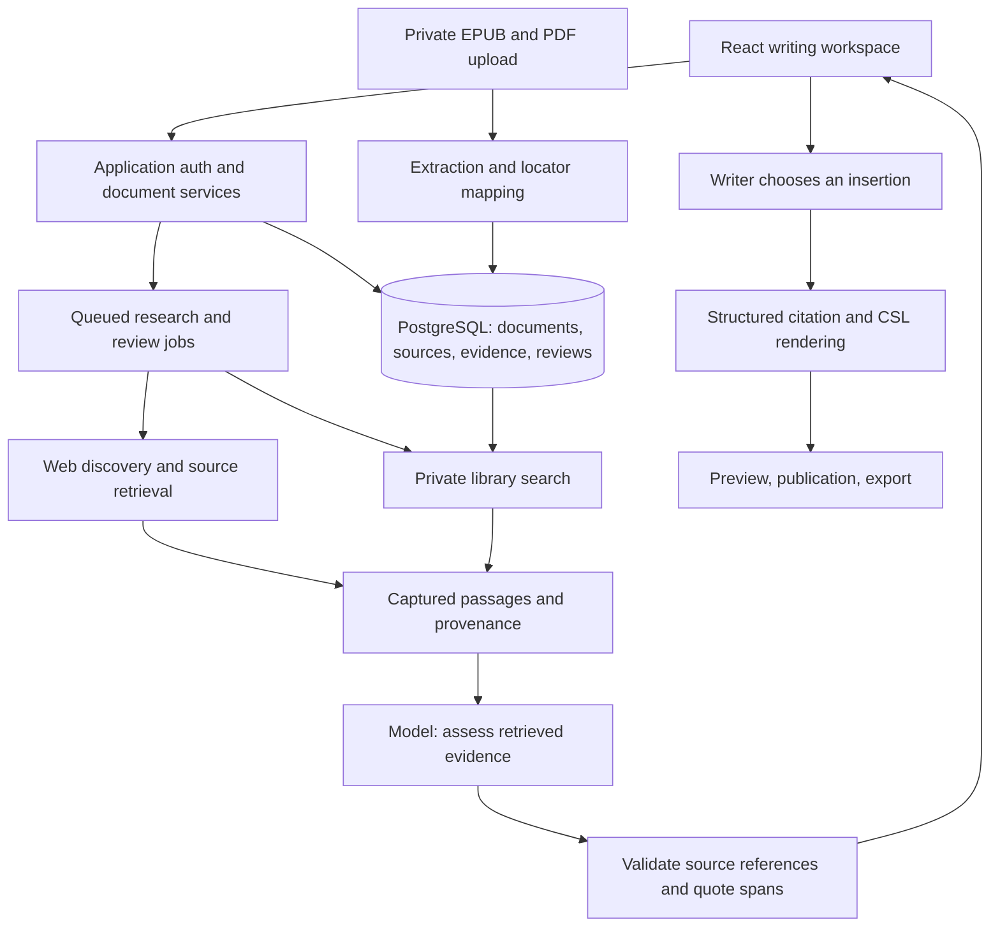

# Athenaeum: a writing workspace with research and evidence review

Prepared November 1, 2026. Analysis and proposal only; no application implementation.

Scope clarified November 1: EPUB books and Great Courses PDFs are a core research collection. The first usable release must support research across that collection and the web together. The sequence and framework assessment below have been revised accordingly.

Verification requirement clarified November 1: checked source identity, quote fidelity, claim support, counterevidence, final-answer auditing, abstention and a claim-level verdict meter are core requirements. The detailed policy and evaluation plan are in [VERIFICATION_DESIGN.md](VERIFICATION_DESIGN.md). No automated truth or accuracy guarantee is implied.

Workflow distinction clarified November 1: **Ask verifies the assistant's researched answer** and presents supporting/disconfirming web links and original-library passage views. **Essay Review evaluates the user's draft**, including its factual premises, reasoning, conclusions and citation integrity. It reconstructs a writer-correctable argument map and assesses critical dependencies; the essay verdict cannot be reduced to citation counts.

## Recommendation

Build a new iteration of Athenaeum around **writing an essay, researching a claim across a private library and the web, inspecting evidence, and inserting a durable citation**. Start from a supported application foundation with a new editor and evidence model. With ingestion and custom retrieval central from the start, Django/Python now has a stronger case; Laravel with a Python processing worker remains viable. React/Tiptap can provide the same interface with either backend. Preserve the existing repository, data, exports, and authored content during that transition.

The two workflows you describe are feasible:

1. **While writing:** select a sentence or ask a question in a research sidebar. Receive an answer with inspectable source passages, supporting evidence, counterevidence, and formatted citations. Copy the result or insert it into the essay.
2. **Review a draft:** examine a completed or half-finished essay's factual claims, reasoning and conclusions against retrieved evidence. See which premises have support, which inferences need work, and which points encounter conflicting evidence or remain unresolved. Accept changes individually.

EPUB/PDF ingestion and research are part of the core workflow. They use the same source, passage, and citation contracts as web research. Ask can use **My library**, **Web**, or **Both**, with Both a natural default when research across the two channels is wanted.

The proposed first release is **a polished personal blog editor with a small ingested EPUB/PDF collection, combined library/web research, and structured citations**. Add completed-essay review after that evidence chain works. This supersedes the initial web-first/PDF-later sequence, which underweighted the user's private-library requirement.

An evidence review can make an essay more defensible. It cannot guarantee that an essay is correct or beyond criticism. The product should expose what was checked, against which sources, and what remains uncertain.

## 1. What I reviewed and what this report establishes

I reviewed `PROJECT_REVIEW.md`, dependency manifests, the current React editor and reading components, routing, controllers, models, migrations, test configuration, and relevant tests. Parallel reviews covered backend/data design, editor UX, and retrieval/citation/PDF tooling. External recommendations below use current primary documentation and are linked at the relevant point.

The checked-out branch is `establishUnitTests`, at `d497937`. Existing changes were present in `app/Models/Category.php` and `tests/Feature/PostTest.php`; `PROJECT_REVIEW.md` was already untracked. These files were preserved.

This was static inspection and public documentation research. I did not launch the application, run tests/builds/installers, contact paid research/model APIs, ingest a document, inspect `.env`, read the database backups, run migrations, or alter application code. Editor suitability and retrieval quality are recommendations to validate in a future prototype, not demonstrated integrations.

Follow-up source inspection: read metadata and representative pages of the supplied `ModernPoliticalTradition.pdf`, and rendered its cover and printed pages 32–33 for layout checks. This was local inspection, without embedding, uploading, or indexing the document.

The previous review is dated October 24, 2026. Its database counts, descriptions of the `develop` branch, dependency advisories, model IDs, prices, and effort estimates are historical findings unless explicitly revalidated here. In particular, I have not independently established the old report's count of three books and 1,217 highlights. Do not use its phrase “the only data worth keeping” as a migration rule: preserve all user-authored material until you decide otherwise.

## 2. What the current code tells us

| Current behavior | Source evidence | Consequence for the redesign |
|---|---|---|
| Laravel 8 API and React 17 SPA, built with Mix; Quill and several UI libraries | `composer.json`, `package.json`, `webpack.mix.js` | A supported foundation and coherent UI stack are preferable to treating this as one extra modal |
| The editor saves Quill's plain text | `resources/js/components/Posts/NewPost.js:306` calls `quill.getText()`; loading also uses `setText()` | Formatting, citation identity, and reliable document anchors require structured document storage |
| Clicking an excerpt inserts quote/title/page strings | `NewPost.js:224–242` reads DOM text and uses `insertText()` | Retain the adjacent-research interaction; replace detached text with linked citation objects |
| A Kindle location is stored as a page | `app/Http/Controllers/BookController.php:65–73`; `resources/js/components/Posts/BookCitationList.js:53–55` | Preserve legacy locations with their correct type; never invent printed pages |
| Sources are books with limited author fields | `app/Models/Book.php`; book/citation/chapter migrations | Need general sources for books, articles, reports, web pages, and their specific versions |
| Posts have a text body and a publication flag, without revisions | `database/migrations/2022_01_30_192846_create_posts_table.php:16–28` | Add document JSON, revisions, review anchors, and explicit publication snapshots |
| Public post reads do not consistently restrict results to published content | `app/Http/Controllers/PostController.php:190–202`; `app/Http/Controllers/UserController.php:58–61` | Separate private writing/research access from public reading queries |
| Ownership checks are missing; the API middleware group alone does not authenticate | `routes/api.php`; `app/Http/Kernel.php:42–46`; citation/chapter controllers | Sources, PDFs, drafts, and research jobs need authenticated ownership policies |
| Post update reads a browser-provided file/URL string and writes to a title-derived path | `app/Http/Controllers/PostController.php:222–243` | Replace this controller implementation and use validated uploads/storage |
| Published content is rendered as HTML without sanitization in the component | `resources/js/components/Posts/ShowPost.js:156` | Use schema validation, safe rendering, and sanitization at the rendering boundary |
| Layout uses fixed editor and excerpt heights | `resources/css/styles.css:1–5,95–102` | Rebuild responsive layout and focus behavior rather than copying the old styling |

The current sidebar is a useful product insight. The obstacle is the underlying representation of writing and evidence, together with the backend's trust boundaries.

### Keep, replace, defer

**Keep:** the project identity if desired; Laravel/React familiarity; public essays; private drafts; topics/tags; the idea of series; the adjacent excerpt panel; existing books, passages, notes, images, imports, and authored posts.

**Replace:** authentication plumbing, ownership enforcement, post/source controllers, editor persistence, citation insertion, the source schema, legacy build tooling, and the visual shell.

**Defer:** multi-author roles, comments, elaborate book/chapter management, Kindle importer improvements, browser extensions, full Zotero synchronization, real-time collaboration, automatic prose completion, and exhaustive reference-manager features.

For an initial personal site, one owner account plus public readers is a reasonable assumption. Keep ownership fields and policies so adding authors later is possible.

## 3. How the earlier plan should change

`PROJECT_REVIEW.md` already contains several strong ideas: sources separate from excerpts, structured citations in posts, CSL metadata, quote provenance, and a fresh foundation. Keep those.

| Earlier emphasis | Revised emphasis |
|---|---|
| Build a personal quote library before writing | Build a thin writing-to-citation path using a representative EPUB, PDF, and web source together |
| Recover Kindle and add multiple capture channels early | Preserve old highlights as optional research leads; imports can follow |
| AI mainly ranks material already in the library | AI can orchestrate research across the library and public web, preserving source identities and uncertainty |
| Source → excerpt → citation | Add source versions, document revisions, claim anchors, and review findings |
| Broad reference-management schema and integrations | Start with enough metadata to cite and inspect a source; normalize further when useful |
| AI near the end of the roadmap | Combined library/web research is central; the editor must still work when AI/search is unavailable |

There is also an important correction to the book discussion: **an absent print page number does not automatically make an e-book uncitable**. MLA says to cite the digital edition actually consulted and omit pages when unavailable. It advises against device-specific location numbers. This supports typed locators and honest missing information, rather than rejecting all e-books. [MLA: citing digital editions](https://style.mla.org/cite-digital-and-oa-books/), [MLA: stable pages and device locations](https://style.mla.org/page-numbers-with-screen-readers/).

Publisher-dependent Kindle export restrictions remain a practical problem. Readwise documents both truncation and missing-page issues, but that is not a reason to treat one percentage limit as universal across all books and export routes. The new product should work without Kindle; it can still accept usable highlights later. [Readwise Kindle integration guidance](https://docs.readwise.io/highlights/docs/importing-highlights/kindle).

## 4. The writing and research interface

### Recommended layout

A clean writing canvas with an optional outline on the left and a **collapsible, resizable research panel on the right**. Use a modal for a quick lookup or source details; a persistent panel is better for several questions while editing because it keeps the essay visible.

```text
 Athenaeum     Essay title     Saved       Research   Review   Preview
 --------------------------------------------------------------------
 Outline       Essay canvas                         Research panel
 optional      readable prose width                 Ask | Sources | Review
               restrained formatting toolbar
               title, headings, paragraphs          Attached selection
               inline citation markers              Question / scope
                                                     Answer + evidence cards
                                                     Open / Copy / Insert
 --------------------------------------------------------------------
               Works Cited / References generated from inserted sources
```

This is a proposed layout, not an implemented prototype. Use a readable prose column of roughly 65–75 characters, restrained accent colors, clear save state, light/dark themes, and generous spacing. Focus mode hides side panels. Familiar formatting and dependable editing matter more than animated assistant UI.

On smaller screens, research becomes a full-height sheet or a separate task view, with a clear return to the selected sentence. Do not compress three desktop columns onto a phone.

### Flow A: research while writing

Ask takes a question and optional selected context. Its output is a researched answer, not an overall essay grade. Supporting, qualifying and disconfirming evidence each have inspectable citation markers with original-source links or EPUB/PDF passage popovers; surrounding context can be expanded beyond the retrieved chunk.

1. Write normally. Select a claim and choose **Research this**, or open Research and ask a free-form question.
2. The panel visibly attaches the selected text. Choose **Web**, **My library**, or **Both**, with optional source/date filters. Ingested books and course documents are available in the first usable research workflow; Both searches both channels and identifies their evidence separately.
3. A neutral default, **Evaluate this claim**, searches for support, qualifications, and disagreement. You can also request an exact quotation, background, or opposing arguments.
4. Receive a brief answer and evidence cards. Each card shows the actual source, author/organization, date, source type, a retrieved passage, locator, access status, and why it may support or challenge the claim.
5. Choose **Open source**, **Copy quote + citation**, **Insert quote + citation**, **Insert citation only**, or **Save source**. Preview quoted text before insertion.
6. Insertion restores the caret, creates a normal undoable edit, and updates the bibliography. No research result changes the essay automatically.

Keep the user's requested copy-and-paste option. Also offer structured insertion: plain copied text cannot reliably update a bibliography or preserve the source relationship. Offer separate copy modes for a quotation, a paraphrase with citation, and a bibliography entry, so generated prose is not mistaken for a verbatim quotation.

### What an evidence card must distinguish

| Item | What the writer sees |
|---|---|
| Exact excerpt | Quoted text from retrieved source material, with enough surrounding context to inspect it |
| AI explanation | A separately labeled summary of relevance, uncertainty, and limits |
| Source identity | Work title, creators, publication details, URL/DOI, and edition where relevant |
| Locator | Printed page, section, paragraph anchor, or other real locator; no invented page |
| Access | Full source inspected, abstract only, search lead only, inaccessible, or OCR needs checking |
| Relation to claim | Supports, qualifies, contradicts, or supplies background; these are suggested assessments |
| Verification | Separate identity, quote/locator, support, evidence-quality and human-review states; unresolved checks remain visible |

A bibliography entry alone is not evidence that the source backs the claim. A search snippet alone should remain a lead, not a verified quotation.

### Flow B: review a completed or partial essay

Use the same editor with claim highlights and a queue in the Review panel. This assesses the user's existing draft and can run on a completed or half-finished essay. Start with a selected section or a whole document, showing scope and a spending/work limit before running a large review.

1. Save a document revision and extract candidate factual assertions, retaining their exact sentence ranges and surrounding context.
2. Show the detected claims so the writer can correct ambiguous wording, combine fragments, or skip claims before deeper research.
3. Separate factual assertions from interpretations, predictions, personal experiences, normative arguments, and theological/philosophical positions.
4. Check existing citations first: does the cited passage support the wording and scope? Is the quote exact? Is the source accessible and appropriate?
5. Retrieve additional supporting and opposing evidence for selected claims. Check dates, populations, causation versus correlation, and whether independent-looking pages repeat one underlying report.
6. Return findings with evidence and optional narrower wording. The writer accepts, edits, dismisses, or marks a finding personally reviewed.
7. Mark affected results stale after claim edits. A review remains attached to the revision it actually examined.

Also reconstruct the thesis, premises, intermediate conclusions and objections, letting the writer correct that map. Check whether supported premises actually warrant the conclusion, including causal leaps, scope changes and hidden assumptions. An original conclusion need not already appear in a source; its evidence and reasoning must withstand review. Critical unsupported dependencies remain prominent in the essay assessment. For partial drafts, unfinished arguments remain pending and the overall assessment stays provisional.

Suggested states are **supported by retrieved evidence**, **partly supported / overstates evidence**, **conflicting evidence**, **contradicted by retrieved evidence**, **insufficient evidence**, **source inaccessible**, and **interpretive/value claim**. Keep **not reviewed** visible as well. “No support found” must not mean “false.”

For philosophy or religion, the system can verify quotations, attribution, dates, or what a text says. It should distinguish these from evaluating whether a moral argument or religious belief is true. For science, it should distinguish study findings from wider conclusions; for politics, it should preserve jurisdiction and date.

Provide a claim-level verdict meter and separate review/citation coverage statistics using the rubric in [VERIFICATION_DESIGN.md](VERIFICATION_DESIGN.md). Any numerical score must state its formula and denominator; it is not a probability that the essay is true. A useful result is: *these claims were examined, these sources support or challenge them, these qualifications matter, and these questions remain open*. Atomic-claim evaluation is an established research pattern, but applying it to this product still requires validation. [FActScore paper](https://arxiv.org/abs/2305.14251), [FEVER evidence-based verification task](https://fever.ai/2018/task.html).

### UX precedents worth borrowing

| Product / documentation | Useful pattern | Boundary |
|---|---|---|
| [Jenni interface](https://docs.jenni.ai/docs/getting-started/introduction/) and [research chat](https://help.jenni.ai/docs/ai-tools/ai-chat/) | Central editor, switchable right panel, selected-text context, citation search and mobile sheets | Inspiration from a hosted product; not an embeddable editor or a reason to require autocomplete |
| [Zotero PDF reader and notes](https://www.zotero.org/support/pdf_reader) | Annotations retain links to the source PDF/page and citations | Its desktop word-processor integration does not automatically extend to a custom web editor |
| [Zotero Quick Copy](https://www.zotero.org/support/creating_bibliographies) | Copy formatted citations/bibliography entries into another writing surface | Useful manual bridge before building synchronization |
| [NotebookLM source citations](https://blog.google/innovation-and-ai/products/notebooklm-goes-global-support-for-websites-slides-fact-check/) | Inspect the supporting passage directly from an answer | Passage traceability is the lesson; a citation does not itself establish truth |
| [Elicit research reports](https://elicit.com/blog/introducing-elicit-reports) and [documented limitations](https://support.elicit.com/en/articles/14757928-elicit-s-limitations) | Research steps and supporting quotations remain inspectable | Missing nuance and imperfect assessment of study quality require visible uncertainty and human review |

These are documented workflow precedents, not hands-on usability comparisons from this review.

## 5. Editor choices

| Editor | Strengths for this project | Tradeoffs | Recommendation |
|---|---|---|---|
| **Tiptap / ProseMirror** | Custom citation nodes, structured JSON, React integration, extensive document extension model; MIT headless core | Polished UI, source panels, citation rendering, review anchors, and recovery are application work; paid features have separate terms | **Preferred starting point** |
| **Lexical** | MIT, React bindings, serializable editor state, extensible nodes, accessibility-oriented foundation | Also requires building the research/citation UX and much of the editor shell | Strong alternative if its programming model feels better in a prototype |
| **CKEditor 5** | Familiar word-processing UI and a broad feature ecosystem | GPL 2+ or commercial terms; footnotes and other premium capabilities affect licensing/cost | Consider if packaged editing features and vendor support outweigh customizability and license concerns |

Sources: [Tiptap open-source scope](https://tiptap.dev/open-source-to-platform), [custom nodes](https://tiptap.dev/docs/editor/extensions/custom-extensions/create-new/node), [JSON/HTML persistence](https://tiptap.dev/docs/guides/output-json-html); [Lexical architecture](https://lexical.dev/docs/intro), [MIT license](https://github.com/meta/lexical/blob/main/LICENSE); [CKEditor licensing](https://ckeditor.com/legal/ckeditor-licensing-options/), [premium footnotes](https://ckeditor.com/docs/ckeditor5/latest/features/footnotes.html).

Tiptap's [Simple Editor template](https://tiptap.dev/docs/ui-components/templates/simple-editor) supplies a useful responsive visual baseline with common formatting and themes. However, its [current UI documentation](https://tiptap.dev/docs/ui-components/getting-started/overview) warns that the prebuilt components work best with React 18 and have incomplete React 19 compatibility. That is a prebuilt-UI caveat, not a blanket claim about Tiptap core. A future spike must test the exact React/editor/template versions; building a thin toolbar over core remains an option.

Treat this as a browser-based essay editor. Pagination, tracked changes, complex Word round trips, or premium DOCX export are separate requirements, not free consequences of choosing a rich-text library. Markdown/HTML plus bibliography export is a sensible initial portability target.

Accessibility belongs to the completed interface: keyboard-operable cards and citations, visible focus, non-color status labels, screen-reader announcements, labeled inputs, modal/sheet focus return, and reliable selection with mobile keyboards. Test long documents, paste, undo, and Safari as well as desktop Chromium. [Tiptap accessibility guidance](https://tiptap.dev/docs/guides/accessibility), [Lexical supported browsers](https://lexical.dev/docs/getting-started/supported-browsers).

## 6. How research becomes a trustworthy citation

The proposed chain is:

**Question → discovery → source retrieval → metadata and passage capture → claim assessment → human selection → citation formatting.**

These are distinct steps. A search provider finds candidates. A language model helps ask questions and assess evidence. A citation processor formats known metadata. None should invent missing information to make the output look complete.

### Roles for external tools

| Tool | Proposed role | What it does not establish |
|---|---|---|
| **Tavily Search / Extract** | Discover relevant URLs and retrieve available page content for public web research | A relevant result or generated answer does not establish that the source supports the precise claim |
| **Wikipedia / Wikimedia APIs** | Orientation, terminology, disambiguation, and discovery of underlying references | Not a universal final authority; inspect the cited original when it is the actual evidence |
| **Crossref / DOI resolution** | Resolve identifiers and bibliographic metadata for scholarly works | Metadata is not full text and does not prove a quotation or conclusion |
| **OpenAlex** | Scholarly discovery, work relationships, and available access locations | An indexed work is not automatically accessible or reliable evidence for this assertion |
| **Zotero / CSL tooling** | Reference capture/import and consistent bibliography/citation formatting | Formatting cannot repair bad metadata or judge whether evidence is relevant |
| **A configurable language model** | Query planning, claim extraction, evidence synthesis, and suggested qualifications | Its unsupported recollection must not enter the system as a source |

Implementation details and provider constraints should be checked against [Tavily Search](https://docs.tavily.com/documentation/api-reference/endpoint/search), [Tavily Extract](https://docs.tavily.com/documentation/api-reference/endpoint/extract), [MediaWiki API](https://www.mediawiki.org/wiki/API:Main_page), [Crossref content negotiation](https://www.crossref.org/documentation/retrieve-metadata/content-negotiation/), [OpenAlex API documentation](https://docs.openalex.org/), and [Zotero's citation-style documentation](https://www.zotero.org/support/dev/citation_styles).

Prefer the original report, dataset, publication, or primary text where appropriate. For broad scientific claims, a good synthesis may be more informative than one isolated study. Source selection should follow the question; institutional branding or domain filters alone are not a quality test.

Seeking counterevidence should not manufacture equal credibility for weak opposing sources. For scholarly material, also check recorded corrections/retractions and show those notices. Crossref provides Retraction Watch data, but absence of a recorded notice does not establish validity. If Wikipedia itself is the source being quoted, preserve its specific revision rather than only the changing article URL. [Crossref Retraction Watch](https://www.crossref.org/documentation/retrieve-metadata/retraction-watch/), [Wikipedia citation guidance](https://en.wikipedia.org/wiki/Wikipedia:Citing_Wikipedia).

### Suggested retrieval behavior

- Search with neutral wording as well as the essay's wording. Look for exceptions and conflicting results, not only confirmation.
- Fetch the promising sources. Preserve successful content and mark extraction failures honestly; do not promote a search preview to full-text evidence.
- Treat Tavily's optional generated answer and relevance scores as aids, not verification. Check publication dates against the original page; search-provided dates can be missing or represent updates. Keep the provider behind an adapter so another search service can be evaluated later.
- Save source metadata, canonical URL/DOI, retrieval time, and the inspected content version. For a quote, save the exact text and surrounding context.
- Ask the model to reference only retrieved passage IDs. Reject references to unknown sources or spans and flag quotations that cannot be matched to captured text.
- Keep text matching and semantic support separate. A passage may exist verbatim yet fail to support the claimed inference.
- Show access limitations such as abstract-only or a paywall. Invite an available document upload or another accessible source rather than inventing the inaccessible passage.
- Preserve unresolved fields for manual correction. Do not infer an author, publication date, edition, page, or DOI merely to complete a citation.
- Apply the mandatory verification policy before releasing research as checked material: unknown references, mismatched quotes, unsupported clauses and unresolved judgments cannot silently pass. Re-audit the final generated answer, including clauses introduced during corrections. See [VERIFICATION_DESIGN.md](VERIFICATION_DESIGN.md).

### Citation styles: one choice per essay

Use one document-level style—MLA, APA, or Chicago—and let it format books, articles, and web pages according to their respective source types. MLA handles online sources as well as books; it is not necessary to switch styles because a source is a website. [MLA online-work examples](https://style.mla.org/works-cited/citations-by-format/online-works/).

Store bibliographic data as CSL-JSON, then use a CSL processor such as citeproc-js or a tested PHP implementation. Prototype the processor with realistic mixed-source documents before deciding its runtime. Footnote numbering, repeated citations, author disambiguation, and bibliography order require document context; formatting isolated strings is insufficient. Zotero documents its use of CSL and citeproc-js. [Zotero CSL documentation](https://www.zotero.org/support/dev/citation_styles).

Support two insertion forms: an ordinary inline citation pointing to a source, and a quote block pointing to a captured passage plus citation. Keep the quote text, any deliberate edits/ellipses, and the original excerpt distinguishable. The same renderer should power preview, publication, and export, with saved metadata/style versions so later corrections do not silently change an already-published essay.

## 7. PDF and book RAG

**RAG means retrieval-augmented generation:** give the system a searchable bookshelf; find the relevant pages first; then let the model answer using those pages. It does not mean training a new model on all your books.

This is feasible for PDFs you can legitimately access and process, especially PDFs with selectable text. It also introduces work that web search cannot solve: OCR quality, reading order, page labels, edition metadata, tables/figures, and exact passage navigation. A PDF is a file format, not a bibliographic source type: the work may be a book, journal article, report, or essay.

### Uploaded Great Courses example

The supplied `ModernPoliticalTradition.pdf` is Lawrence Cahoone's *The Modern Political Tradition: Hobbes to Habermas*, The Great Courses / The Teaching Company, copyright 2014. It has 304 physical PDF pages and 36 lecture guides, with suggested readings, discussion questions, and an annotated bibliography. Sampled prose has extractable text; no OCR was needed for those pages.

It carries real PDF page labels: printed page 1 is physical file page 9; Lecture 5 on Locke starts at printed page 32, physical file page 40. Keep both locators. Printed page 33 includes an illustration/caption beside prose, so reading order needs checking. Embedded metadata lacks title/author; propose these from the front matter for confirmation rather than treating the 2015 file-creation date as publication year.

This is an instructor's guide, not a verbatim transcript or the philosophers' original works. A retrieved explanation of Locke should cite Cahoone and the guide's page. Cite Locke directly only when his actual text has been retrieved. Suggested readings and bibliography entries are discovery leads, not proof that their referenced works have been inspected.

### EPUBs and combined retrieval

EPUB ingestion preserves the original file, edition/translation metadata, reading order, chapter/section hierarchy, internal document anchors, and exact passage text. Use stable chapter/section locators when no reliable print pagination exists. Current Docling documentation lists both PDF and EPUB input, although extraction quality still needs testing with representative files. [Docling supported formats](https://docling-project.github.io/docling/usage/supported_formats/).

After ingestion, retain originals and passages in authoritative storage and index passages for both keyword and vector retrieval. A vector index can contain many books/course guides with metadata filters; a separate database per book is unnecessary. When Both is selected, retrieve from the permitted library and the web, combine/rerank useful candidates, recover surrounding context, and synthesize an answer with distinct Book, Course guide, and Web evidence cards. Do not imply that every document in the collection was read in full to answer each query.

### A proposed ingestion path

1. Upload a private file and record its hash, owner, filename, and access permissions. Preserve the original.
2. Extract text and layout with a tool such as Docling; use OCR when needed. Record extraction/OCR version and failures.
3. Ask the writer to confirm title, creators, publication details, edition, and identifiers. A parser cannot reliably recover all of these from every document.
4. Retain page provenance for text: PDF file page index, printed page label when known, section, and bounding boxes/character spans where available.
5. Split along paragraphs/sections with moderate overlap while retaining the mapping to original pages. Cross-page passages must keep their actual range.
6. Index full text and embeddings. Search with both exact terms and semantic similarity; optionally rerank a small candidate set.
7. Answer from retrieved passages and provide **Open PDF at page** with a highlighted region where possible. Let the writer inspect the original before inserting a quote.

Docling's document model includes provenance fields for page numbers, bounding boxes, and character spans, making it a candidate for this job. That does not guarantee perfect extraction or supply print-page labels automatically. [Docling document schema](https://docling-project.github.io/docling/reference/docling_document/).

Keep raw extraction separate from normalized search text. Removing line-break hyphens or adjusting whitespace can help retrieval, but displayed quotations must remain traceable to the original text and page image. Structure-aware chunking is available, yet still needs testing against your actual documents. [Docling chunking documentation](https://docling-project.github.io/docling/concepts/chunking/).

### Page precision is a first-class requirement

“PDF page 23” and “printed page 7” may refer to the same sheet because of front matter. Roman numerals, missing labels, multi-column reading order, and footnotes complicate mapping. Keep both page systems; use a verified printed label for a printed-page citation and show file-page navigation separately. If labels are unknown, say so and use a suitable honest locator instead of pretending the file index is a printed page.

Text extracted from scans may contain OCR errors. A quote matching OCR output proves a match to that extraction, not to the original image. Keep the page view and a separate human verification state.

### Database choice

PostgreSQL with full-text search and pgvector is a simple proposed starting point for the first library pilot. An existing dedicated vector service can also be evaluated; the key requirements are provenance, filtering, and retrieval quality. Laravel's current Scout documentation supports semantic/hybrid search through its database engine on PostgreSQL with pgvector. [Laravel Scout semantic and hybrid search](https://laravel.com/framework/docs/13.x/scout#semantic-and-hybrid-search).

A dedicated vector service remains an option if measured corpus size, latency, filtering, or operations justify it. RAG itself does not require Pinecone or LangChain. A small pipeline with explicit stages will be easier to inspect while learning. Keep embedding model/version/dimensions with the index and use compatible query embeddings; a model change requires deliberate reindexing.

Web research and private-library search should return the same evidence-card format. Show which scope supplied each passage. Apply ownership restrictions before material enters retrieval results or model context. A private uploaded book stays private when an essay cites a short selected passage.

## 8. Proposed architecture and data model

Use one modular application with a React editor and background jobs for ingestion, research, and review. Django/Python would let the application share modules with Python extraction/retrieval/evaluation code; Laravel plus a narrowly scoped Python worker remains an alternative that builds on the user's Laravel experience. Choose between them with the core library requirement included, rather than assuming most research is external API calling. Avoid two full web backends.



The model suggests. The document service controls writes. Keep external retrieval content outside the authority that changes documents or executes tools.

### Technology direction

| Concern | Proposed choice |
|---|---|
| Application | Django/Python is now the leading research-pipeline candidate; supported Laravel plus a Python worker remains viable |
| Frontend | React, TypeScript, Vite, a restrained component system; Laravel's Inertia starter is one option if Laravel is chosen |
| Authentication | First-party session authentication and ownership policies |
| Editor | Tiptap core with citation nodes; exact UI/version combination validated first |
| Data | PostgreSQL; JSONB document/CSL metadata; full-text and vector retrieval for the first library slice |
| Research | Tavily adapter plus fetch/extraction, scholarly metadata/discovery adapters, configurable model adapter |
| Citations | CSL data and a tested processor; no model-generated bibliography formatting |
| Long tasks | A production queue/worker setup for the chosen backend, progress updates, cancellation, retries, request deduplication |
| Files | Private storage for originals and captures; a separate public-asset path for published images |
| EPUB/PDF extraction | Core first-release pipeline; evaluate Docling and format-specific extraction against representative documents |

Laravel 13 requires PHP 8.3 or later within its documented support matrix. Its current React starter kit uses React 19, Inertia, TypeScript, Tailwind, and shadcn/ui. Those are available foundations, not a claim that all proposed third-party components are compatible without testing. [Laravel release/support policy](https://laravel.com/framework/docs/13.x/releases), [React starter kit](https://laravel.com/framework/docs/13.x/starter-kits).

These Laravel details describe an available alternative, not a settled framework decision. Python's attraction is direct access to processing libraries and a shared ingestion/retrieval codebase. Public essays can use server-rendered pages with either choice; there is no need to add a separate Next.js frontend merely to obtain a modern editor.

### Minimum records worth designing

| Record | Purpose |
|---|---|
| Document / revision | Structured editor JSON, stable node IDs, revision identity, citation style, publication snapshot |
| Source | CSL metadata, source type, identifiers, owner; edition-specific identity where needed |
| Source version / asset | The retrieved page or uploaded file actually inspected, hash, timestamps, extraction version, access state |
| Passage | Verbatim text, context, source-version ID, locator, page/span mapping, capture method, verification state |
| Citation occurrence | Stable occurrence ID in a document/revision, source/passage IDs, locator overrides, quote or paraphrase use |
| Research run | Question, selected context, permitted scopes, provider/model, search trace, sources consulted, usage, status |
| Review run / claim / finding | Exact reviewed revision, anchored claim text, evidence links, suggested relation/verdict, limitations, writer decision |

The editor document is the authority for citation placement. Derive any relational citation index from it transactionally; do not maintain two independent versions of the same citation list. Use stable editor IDs plus revision/text context for review anchors rather than only raw character offsets. Published content and its cited source metadata should be reproducible even when a source or draft later changes.

## 9. Reliability, privacy, and operating cost

These controls are directly relevant to the new features:

- **Draft recovery:** autosave with visible saved/saving/failed states, recoverable revisions, and optimistic concurrency so two tabs cannot silently overwrite one another. Research outages must not stop writing.
- **Evidence integrity:** store original retrieved text/version; reject unknown passage references; keep source-text matching separate from human verification and semantic support.
- **Verification gate and scoring:** use one evidence-verification service for Ask and essay review, with explicit pass/fail/unknown checks, a source-conditioned claim verdict, counterevidence, bounded repair, revision invalidation and audit records. User overrides retain their unresolved status. Benchmark false acceptance before promoting results as checked.
- **Safe retrieval:** untrusted web pages/PDFs are evidence, never instructions. Restrict tool capabilities; validate outbound URLs/redirects and block local/private network targets. Keep keys and retrieval behind the server.
- **Private material:** show what context goes to external search/model providers. Send the selected claim and necessary context rather than an entire essay by default. Whole-essay review can process a draft through the configured model, but external search should still receive scoped queries. Private library content needs an explicit provider/local-processing choice.
- **Publication boundary:** private attachments and research history are not published with a post. Render only the selected public material and citations through safe templates.
- **Bounded jobs:** limit searches, source fetches, document size, and model context; show progress, partial failures, cancellation, and per-run usage. Retry transient errors without duplicating insertions or charges unnecessarily.

Tavily research usage, language-model tokens, embeddings/reranking, OCR/extraction compute, file storage, and background hosting all contribute to cost. Full-essay review can cost substantially more than a single question because it repeats research across claims. Cache reusable metadata and captured sources, deduplicate claims/queries within a run, and offer **selected section / whole essay** plus **quick / deeper review** scopes.

Do not adopt the old review's model IDs, exact prices, or fixed timeline estimates as requirements. Compare providers with representative essays and record actual usage first. Check current account allowances and pricing at implementation time, including [Tavily usage/pricing documentation](https://docs.tavily.com/documentation/api-credits) and any scholarly API's access requirements. This report did not run a paid cost benchmark.

OpenAlex, for example, currently permits basic keyless queries and offers keys with higher budgets, alongside metered usage and paid options. It should not be designed around an assumption of unlimited free requests or document downloads. [OpenAlex authentication and limits](https://help.openalex.org/api/authentication/).

## 10. Rebuild versus upgrade, and preserving the old work

| Approach | Assessment |
|---|---|
| Extend the existing Quill app | A fast visual experiment, but the text/citation model and authorization problems remain; poor long-term fit |
| Upgrade the existing code in place | Possible, but much of the upgraded editor, auth, controllers, and schema would then be replaced |
| **New supported foundation with deliberate migration** | **Recommended:** isolate new development, retain the legacy app/data, and port useful behaviors and content |
| Existing writing tools plus Zotero | Useful immediate benchmark/manual workflow; may satisfy some needs without custom development, but less control over the integrated evidence/review/publishing experience |

So yes: **effectively retire this iteration and build a new front end and backend foundation**. That does not require changing technology families, discarding the project history, erasing the database, or recreating every legacy feature.

If implementation is later authorized, use a new isolated directory/worktree or repository and a separate development database. Do not overwrite the existing tree to install a starter kit. Inventory and export legacy content recoverably, preserving IDs and source files, before importing into the new model.

Migration should retain all authored posts, publication states, images, sources, passages, notes, and raw exports. Original Bookcision files may recover metadata the importer discarded. Imported Kindle numbers remain `location`, not `page`; pasted legacy citations remain unverified text unless a person confirms a mapping. Do not attempt to reconstruct lost Quill formatting automatically.

Validate migration counts, Unicode passages, assets, publication status, identity mappings, and representative source links against the actual selected legacy dataset. Keep the legacy copies for rollback and defer cutover until the new workflow is accepted. The old review's branch/database compatibility findings must be checked before choosing an export path.

## 11. A practical sequence after approval

These are proposed stages, not work started in this review.

| Stage | Deliverable | Acceptance gate |
|---|---|---|
| **0. Focused design and compatibility prototype** | Test editor/React compatibility and a representative EPUB, Great Courses PDF, and web source through a shared evidence/citation contract | One question can retrieve from both channels and each evidence card opens the correct original passage; citation insertion survives save/reload and style changes |
| **1. Writing and publishing foundation** | Owner authentication, draft editor, revisions/autosave, manual/URL/DOI sources, structured citations, bibliography, public essay page, basic export | Write and publish a complete cited essay without AI; drafts and private sources remain private |
| **2. Library ingestion and combined research while writing** | EPUB/PDF ingestion, confirmed metadata, locator mapping, keyword/vector retrieval, web discovery/extraction, unified evidence cards, copy/insert, scoped queries | A curated set of questions finds relevant book/course/web passages, preserves primary-versus-secondary attribution, surfaces contradictions and failures, and rejects absent quotes |
| **3. Completed-essay evidence review** | Claim selection, existing-citation audit, supporting/opposing evidence, anchored findings, revision staleness, writer decisions | Correctly distinguish tested supported, contradicted, unresolved, overbroad, and normative cases; editing invalidates affected findings |
| **4. Broader library coverage** | Extend the working EPUB/PDF pipeline to difficult scans, multi-column layouts, collections, and larger corpora | Preserve locators and permissions across formats; poor OCR or missing evidence triggers uncertainty rather than invented quotations |
| **5. Useful extensions** | Selective legacy import, Zotero import/sync, better PDF handling, additional sources, series or comments if wanted | Each extension improves the actual writing workflow enough to justify its maintenance |

Stage 0 should be narrow enough to resolve uncertainties, not become a second full app. First validate the interaction and data contracts; then build one usable end-to-end writing path before adding more integrations.

### What future validation must prove

Use a deliberately small evaluation set with known sources and manually checked answers. Include negated claims, conflicting sources, repeated syndicated reports, abstract-only results, inaccessible pages, incomplete metadata, stale evidence, OCR errors, fabricated quote attempts, and claims outside empirical verification.

Measure citation correctness, quotation fidelity, whether retrieved evidence actually supports the sentence, whether counterevidence was missed, abstention when evidence is inadequate, latency, and cost. Retrieval relevance alone is insufficient. Also test unauthorized access to drafts/PDFs, unsafe rendering, save recovery, stale review anchors, paste/undo, and citation/bibliography round trips.

The current PHPUnit configuration does not establish a dedicated test database: isolated SQLite settings are commented out. No feature tests were run during this review. Future database-backed verification must use an explicitly isolated database, not whatever credentials the legacy app currently loads.

## 12. Suggested direction to take forward

Start with **a personal writing workspace and a research engine spanning ingested EPUBs, Great Courses PDFs, and the web**. Use a Tiptap-based React editor, traceable source cards, structured citations, and public essays. With the clarified emphasis, favor Django/Python for direct processing/retrieval integration unless Laravel familiarity plus a Python worker proves the better practical tradeoff. Use web discovery alongside private-library retrieval, CSL for formatting, and a configurable model for evidence assessment. Add completed-essay review after the shared evidence chain is reliable.

This keeps the central promise concrete: while writing, you can ask a question, inspect the evidence, understand its limits, and insert a citation that still leads back to the material you actually consulted.
