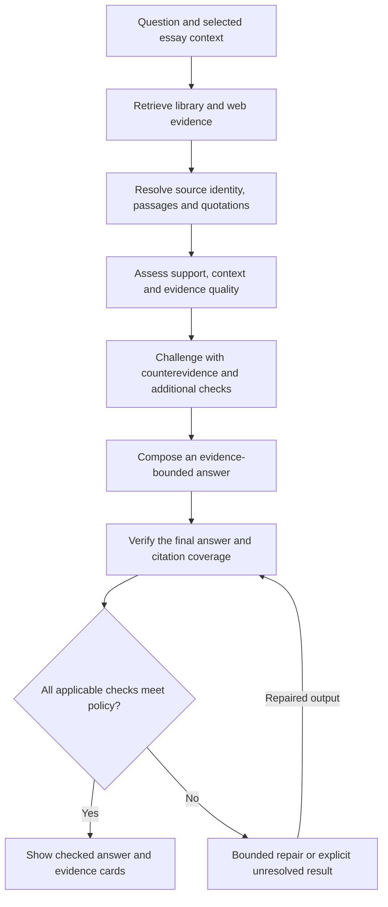

# Athenaeum: evidence verification and claim review

Design proposal, November 1, 2026. No application implementation or live verification integration has been performed. This document extends `RESEARCH_WRITING_REDESIGN.md` with a mandatory verification stage shared by Ask and whole-essay review.

## 1. The product promise

Every ready-to-use research result should identify the material actually inspected, show the checks performed, and disclose unresolved limitations. Failed or unresolved evidence must not be promoted to a verified citation or an established fact.

**Validated means that a defined set of checks passed against particular evidence at a particular time.** It does not mean a model has certified objective truth. The system can perform exact checks on source references and quotation text; assessing whether evidence supports a claim and whether the evidence is reliable remains fallible.

Distinguish these findings:

1. A source exists and its identity matches the reference.
2. A quotation occurs in the inspected source version at the recorded location.
3. The passage supports the precise claim, including its qualifications.
4. The evidence is appropriate and withstands checks for corrections, counterevidence, and source dependence.
5. A human inspected the evidence and decided to use it.

One finding must never silently imply the others. A source can contain a real statement that is mistaken. A genuine quotation can be used misleadingly. A valid citation can supply counterevidence rather than support.

### Two distinct workflow contracts

Ask and Essay Review share evidence retrieval and verification services, but they evaluate different material and produce different outputs.

| Contract | Ask | Essay Review |
|---|---|---|
| Input | A question, with optional selected essay context | A saved snapshot of the user's completed or partial essay |
| Material under assessment | The assistant's proposed research answer | The user's assertions, quotations, citations, reasoning and conclusions |
| Main output | A substantiated answer with supporting, qualifying and disconfirming evidence, plus unresolved questions | A writer-correctable claim ledger and argument map, individual findings, and an overall evidence/argument assessment |
| Citation interaction | Inspect original web/library passages, follow links, save or insert selected evidence | Inspect the evidence attached to a specific claim or inferential step, then choose revisions |
| Scoring unit | Each factual assertion in the answer and its evidence relationship | Individual factual claims and premise-to-conclusion connections, followed by an essay-level assessment |

An Ask question need not assert a position. Research should answer it neutrally and may present several substantiated interpretations. Reviewing an essay must not replace the writer's argument with a new assistant-generated answer.

## 2. Verification stages

| Stage | Proposed check | Outcome and limits |
|---|---|---|
| Source identity | Resolve an imported source or retrieved URL/DOI/ISBN; compare title, creators, publication details and edition | A resolving DOI attached to the wrong paper fails. A missing lookup or dead link remains unresolved; it does not prove fabrication |
| Inspected version | Keep original file or retrieved content, capture time, source/version ID and content hash | Makes the result reproducible. A hash proves content identity, not author/publisher authenticity |
| Passage and locator | Resolve the permitted passage ID to original text, chapter/section or printed/file-page mapping | A made-up passage ID or wrong source/page fails; EPUB locators need not be print pages |
| Quote fidelity | Match quotation spans to the stored source text using controlled normalization with original-span mapping | Exact matching is a mechanical check. OCR output still needs an original-page review when uncertain |
| Attribution and context | Inspect surrounding context, speaker, edition/translation and primary-versus-secondary status | An instructor explaining Locke is not Locke speaking; a reading-list entry does not imply access to the referenced work |
| Claim support | Evaluate each factual proposition against its evidence, preserving negation, quantifiers, dates, population and jurisdiction | Return supports, partly supports, contradicts, or insufficient evidence, with passages and an inspectable rationale |
| Numeric and causal checks | Recalculate arithmetic/units when inputs are available; inspect table headings/footnotes and causal wording | A correct copied number may still have the wrong denominator, date, population or interpretation |
| Evidence challenge | Seek meaningful counterevidence, material corrections/retractions and independent corroboration where appropriate | Several syndicated pages repeating one study count as one underlying evidence chain; a fixed number of links is not a quality guarantee |
| Final output audit | Re-extract factual claims and citations from the actual final answer, then rerun applicable checks | Stops new unsupported clauses introduced during synthesis or repair from bypassing earlier checks |

All stages record **pass**, **fail**, **unknown**, or **not applicable**, with the inspected evidence and method. Workflow completion and a claim's factual verdict are separate fields.

### Source-controlled generation

The model may request and cite only source/passage IDs from a server-controlled registry. Application code resolves those IDs into titles, URLs, bibliographic entries and quote text. Unknown IDs fail validation. Quotation insertion should use the captured passage, rather than a model-reconstructed version of it.

Validate claim-to-citation relationships too: a valid source ID attached to an unrelated sentence is not a successful citation. Every factual clause that needs evidence must have adequate supporting attribution or an explicit unresolved status.

### Quotation edge cases

- Preserve original text separately from normalized search text. Normalization must not silently change the displayed quote.
- Whitespace, Unicode, line wrapping and line-break hyphenation need defined, reversible handling. Do not silently normalize away meaningful punctuation or negation.
- Ellipses and bracketed alterations need ordered source spans and visible editing, plus a context check. Fuzzy similarity alone cannot certify a quotation as exact.
- A model-generated translation is labeled a translation, not an exact quotation from a published translated edition. Edition and translator belong to the source identity.
- Text matching against OCR establishes a match to the extraction. Uncertain OCR remains flagged until checked against the page image.

## 3. A checker separate from the answerer

Use a separate verification pass that receives the exact claim and original evidence context, preferably without the answerer's verdict. It should identify supporting and conflicting passages and explain missing qualifications. Targeted additional retrieval can resolve uncertainty.

A different model/provider or an entailment model can provide another signal. Agreement between models must not be treated as proof: they may share errors, rely on the same inadequate passage, or misinterpret the same evidence. An unresolved disagreement should reduce the willingness to accept the claim.

The verifier itself must be evaluated against manually reviewed examples from the actual subjects and document formats. Do not use a model's self-reported confidence as a calibrated probability.

The ALCE research evaluates citation quality alongside correctness, supporting separate evaluation of citation support and coverage. A recent HALLMARK preprint tests bibliographic verifiers and reports both missed errors and incorrect flags; that study concerns reference verification, not a universal benchmark of claim truth. [ALCE](https://arxiv.org/abs/2305.14627), [HALLMARK, October 2026 preprint](https://arxiv.org/abs/2607.18360).

## 4. Strict mode for Ask

### Answer and evidence interface

The response should distinguish **Answer**, **Supporting evidence**, **Disconfirming evidence / limitations**, and **What remains unresolved**. Attach citation markers to the particular answer clauses they concern. Do not imply that challenging evidence has equal credibility merely because it appears in the opposing group.

Clicking a citation opens an inspectable evidence popover or side-panel passage view:

- Web: original URL, creator/publication/date, captured passage, surrounding context, access state and retrieval time.
- EPUB: work/author/edition/translator, chapter or section locator, original passage and a route into the local reader.
- PDF/course guide: work/instructor, lecture/section, printed page label and physical file page, passage and an original-page view.
- All source types: supports/qualifies/contradicts/background relationship, relevant verification outcomes, and the basis for that relationship.

Supporting and disconfirming evidence receive the same inspection controls. Offer expansion beyond the retrieved chunk. A vector chunk locates material; the original work/version and locator supply the citation. Display captured source text separately from AI summaries. Private library views require the writer's access rights; citations must not expose a whole private file publicly.

The default research flow should be:

The repair path has a configured limit. Do not repeatedly regenerate until a model eventually approves itself. Exhausted, failed, inaccessible or disputed cases remain visible as such.

Strict mode behavior:

- Do not display unchecked streamed factual prose as the checked answer. Progress can stream immediately; release factual answer units after their checks finish. Another option is to hold the complete answer until its final audit passes.
- Withhold unsupported factual clauses from the normal answer. Show a clearly separated unresolved result such as: “I could not substantiate this claim from the material searched.”
- Show a compact search record: selected library scope, web scope, retrieval date, sources actually inspected, failures and limitations. Do not imply every book or the entire internet was examined.
- Offer source details and original text even when a claim cannot be settled. Source accessibility, quotation matching and factual support remain distinct statuses.
- Failed source/quote checks prevent the normal ready-to-cite action. Missing evidence is shown as a research lead requiring attention.
- Valid evidence that challenges the writer's claim remains useful: offer it as counterevidence, with the relationship labeled. A positive support verdict is not required to quote an opposing position accurately.
- A writer can accept, reject, revise or manually use material despite a warning. Such an override retains the unresolved/failed status and records the writer's decision; it does not become machine-verified.
- Existing essay text remains editable. Research does not silently remove or rewrite it.

“No supporting evidence found” describes the search result and its scope. It must never become “There is absolutely no supporting source anywhere.”

## 5. Whole-essay review

Review a saved revision, keeping stable editor anchors and surrounding text. The process covers uncited assertions, existing citation relationships, direct quotations, the bibliography and the reasoning connecting premises to conclusions.

1. Detect candidate factual claims, including individual propositions inside multi-part sentences. Keep context so decomposition does not change the meaning.
2. Show the detected claim list for writer correction. Claim detection itself may miss material; allow manually adding a missed claim.
3. Classify factual assertions separately from interpretations, opinions, predictions, personal experiences and normative arguments. Verify factual premises and attributions even where the broader argument cannot receive an empirical truth rating.
4. Audit existing citations: source identity, edition/version, locator, quote text and support for the associated wording. Identify orphaned references and claims whose current citations do not support them.
5. Retrieve relevant library and web material within the selected scope, including counterevidence. Run the same verification stages as Ask.
6. Return claim verdicts, evidence cards, limitations, suggested qualifications, and explicit pending/failed items.
7. Let the writer choose revisions and evidence. A changed claim, citation or source version invalidates affected findings. A review never silently transfers to an edited revision.

### Reconstruct and evaluate the user's argument

Build a writer-correctable map of the thesis, factual premises, definitions, intermediate conclusions, objections and assumptions. Link each item to the exact draft span. Mark inferred assumptions as the system's reconstruction until the writer confirms them; never silently attribute a reconstructed position to the author.

Link premises to the conclusions they are intended to support. Evaluate those connections separately from the factual status of each premise:

- Are the premises acceptable given the inspected evidence?
- Are they relevant to this conclusion?
- Are they sufficient for the conclusion's strength and scope?
- Is an unstated premise required?
- Does the inference introduce causal language, a universal claim, circular reasoning or a change of meaning?
- Does material counterevidence undermine a premise, the inference, or only a narrower aspect of the conclusion?

A novel conclusion need not have been stated by another author to be justified. The review assesses its factual premises and inferential bridge. Conversely, a source agreeing with a conclusion does not by itself establish sound reasoning.

For example, in a hypothetical essay, “A city opened a park” and “wellbeing increased afterward” might both have documentary support. The inference “the park caused the increase” can still be unestablished. An aggregate count of supported facts must not hide that central inferential gap.

Identify critical thesis dependencies separately from background details, with writer confirmation. An unsupported critical premise or inference keeps the central conclusion flagged even if many minor facts pass. Do not count repeated formulations of the same proposition as independent confirmations.

Normative conclusions can be assessed conditionally against declared values and factual premises. Do not assign an empirical True/False label to the underlying value choice. For half-finished essays, assess the text present, mark undeveloped connections and planned research as pending, and label the overall result provisional. An unwritten future argument is not false.

Argument mining and argument-quality research provide precedents for identifying argumentative structure and distinguishing several dimensions of quality; they do not establish the accuracy of the proposed automated reviewer. [Essay argument mining](https://aclanthology.org/C16-1158/), [argument-quality assessment](https://aclanthology.org/E17-1017/).

VeriScore is relevant because it evaluates verifiable content within texts that also contain unverifiable material. Its research results do not establish the accuracy of this proposed application. [VeriScore](https://aclanthology.org/2024.findings-emnlp.552/).

## 6. Verdict meter

Use a visible claim verdict alongside the evidence checklist. PolitiFact offers a useful editorial precedent for graded factual judgments, but its reporter/editor process is not equivalent to an automated score. FactCheck.org also describes separate review of factual assertions and conclusions against sources. [PolitiFact methodology](https://politifact.com/article/2018/feb/12/principles-truth-o-meter-politifacts-methodology-i/), [FactCheck.org process](https://www.factcheck.org/our-process/).

| Primary display | Meaning |
|---|---|
| Supported / “True within checked scope” | Appropriate inspected evidence supports the material factual components; no material unresolved contradiction was identified within the reviewed scope |
| Mostly supported | The core is supported, but a qualification or narrower wording is needed |
| Mixed | Components have different results; split the claim where possible |
| Disputed | Credible evidence or relevant authoritative interpretations conflict |
| Mostly contradicted | Some detail survives, but the important factual proposition conflicts with the evidence |
| Contradicted / “False” | Sufficiently strong, scope-matched contradictory evidence outweighs the supporting material under the defined review policy, with no unresolved material credible conflict |
| Unsubstantiated | Insufficient evidence was found to support or refute the claim in the searched material |
| Cannot assess | Access, extraction, ambiguity or review disagreement prevents an adequate assessment |
| Interpretation / opinion | The broader statement does not receive an empirical truth rating; its factual premises and attributions can still be checked |

**Not reviewed**, **review in progress**, and **stale after edit** are workflow states, not truth verdicts. No color-only labels.

When credible evidence supports both sides and the conflict cannot be resolved, use **Disputed** or **Cannot assess**. A single contradicting source is insufficient for False. A failed search without adequate supporting or contradicting evidence leads to Unsubstantiated. These rules take precedence over an individual model's preferred rating.

“Meh” is too ambiguous for the underlying rubric. Playful display language can be optional, but the precise meaning and evidence must remain accessible. An automated false verdict must not imply that the writer intentionally lied.

### Evidence checklist beside the meter

Show states such as:

- Source identity resolved.
- Passage/locator resolved.
- Quote text matched, or quote not applicable.
- Original-image/OCR review pending when relevant.
- Claim support assessed.
- Material limitations and counterevidence considered.
- Automated assessment date and scope.
- Writer personally reviewed / not personally reviewed.

Use wording such as **“Text matched to captured source”** and **“Claim supported by reviewed evidence.”** Avoid one general badge that conflates existence, accuracy, reliability and truth.

## 7. Essay scores and coverage

A useful numerical score measures a defined property of the review, with its denominator and limitations visible. It should not look like a probability that an essay is true.

An illustrative result:

> 24 of 28 detected factual claims reviewed.
>
> 17 supported; 4 need qualification; 2 contradicted; 1 unresolved; 4 pending.
>
> 12 of 12 citation identities checked. 9 of 10 quotations text-matched.

Possible separately labeled metrics:

- **Review coverage:** reviewed detected factual claims / all detected factual claims.
- **Fully supported claim coverage:** fully supported detected factual claims / all detected factual claims.
- **Citation integrity:** citation occurrences passing the applicable identity/locator checks / citation occurrences requiring checks.
- **Quotation fidelity:** quotations passing the applicable original-text check / quotations requiring checks, with OCR-only matches identified separately.
- **Argument assessment:** whether the premises and inferential connections justify the central and intermediate conclusions, including material assumptions and counterevidence. Initially report this as findings and a calibrated rubric, not an arbitrary probability.

These are evidence-review statistics. Pending and unresolved claims remain visible; opinions are classified separately; missed claims remain possible. Do not compute an attractive percentage from only the claims that happened to pass.

For an overall essay status, use an actionable label such as **“Needs revision: contradicted claims and unresolved evidence remain.”** Keep a contradicted central premise prominent even when many minor facts are supported. Any future weighted composite would need an explicit formula and validation; it should not be invented by the model.

The main essay assessment should distinguish **well substantiated within scope**, **substantiated with qualifications**, **mixed/disputed**, **central conclusion not established**, and **provisional/incomplete**. These assessments consider critical factual and inferential dependencies, rather than averaging citation counts. “Not established” does not mean false.

A requested 0–100 evidence-support index can be considered after publishing the rubric, claim-importance policy, treatment of unknowns and coverage requirements, and validating it against human-reviewed essays. Any displayed score must retain the underlying distribution, critical issues and review coverage. No composite may average away a failed central premise; insufficient coverage prevents a confident overall verdict.

## 8. Audit and versioning

Record the exact reviewed claim and document revision; source/passage/version IDs; capture and review times; allowed search scope; actual source material; check outcomes; evidence-based rationale; applicable model/tool/policy versions; limitations; and writer decisions.

For Essay Review, also retain the writer-corrected argument structure and premise-to-conclusion links. Editing a premise or resolving new counterevidence can invalidate dependent conclusions even if their wording stays unchanged.

Keep a concise explanation of the evidence, not hidden model chain-of-thought. Cache checks only while the exact claim, evidence, source version and verification policy remain compatible. Metadata corrections must not silently rewrite previously published evidence records.

Imported/fetched text is untrusted source material. Instructions embedded in it must never control the verifier, change the rubric, grant tools, or modify the essay. Ownership restrictions apply before retrieval and model context assembly.

## 9. What must be validated before release

Build a held-out, manually reviewed evaluation set using representative EPUBs, course PDFs, scanned pages and web sources across the intended subjects. A first prototype should include the uploaded course-guide format, a primary EPUB and an accessible web source.

Required adversarial cases include:

- Invented references and invented quotation spans.
- Real DOI/ISBN with wrong title, author, edition or claimed passage.
- Inaccessible genuine sources and dead links that must remain unresolved.
- Swapped sources or page labels; wrong translation; instructor summary attributed to a philosopher.
- Exact quotations with misleading omissions, changed negation, ellipses or surrounding context.
- OCR errors, columns/captions interleaved with text, and tables with missing units/footnotes.
- Unsupported causal language, universal claims drawn from limited samples, wrong dates/jurisdictions and incorrect arithmetic.
- Multiple web pages repeating one underlying source.
- Conflicting evidence and relevant corrections/retractions.
- Normative arguments, interpretations and genuine open questions.
- Factual clauses added during final synthesis after the initial evidence checks.
- Prompt injection in retrieved material and unauthorized private-library retrieval.
- Writer overrides and edits that must not retain a false verified state.

Measure source/quote errors separately from support judgment. Prioritize **false acceptance of unsupported claims**, and also measure false rejection, missed claims, retrieval coverage, citation completeness, appropriate abstention, reviewer disagreement, latency and cost. Validate on held-out examples; do not optimize against the same examples used to choose prompts and thresholds.

An LLM confidence percentage is not a production acceptance threshold. Any numeric confidence or automated “True” presentation needs calibration against manually reviewed outcomes, with its limits documented. The AVeriTeC research evaluates evidence retrieval together with verdict quality, providing a useful evaluation principle. [AVeriTeC 2.0](https://fever.ai/2025/task.html).

## 10. First implementation slice, if authorized later

First establish source registry, versioned passages, exact quotation/locator checks, honest unresolved states and a final-answer coverage gate. Then add evidence-conditioned support assessment and counterresearch with a manually reviewed benchmark. Add essay claim extraction, a claim-level meter, revision invalidation and coverage reporting on the same verification service.

Mandatory verification belongs in the first usable research release. A polished meter without evaluated evidence checks would not satisfy the user's requirement. This document specifies the intended contract; no stated accuracy has yet been demonstrated for Athenaeum.
