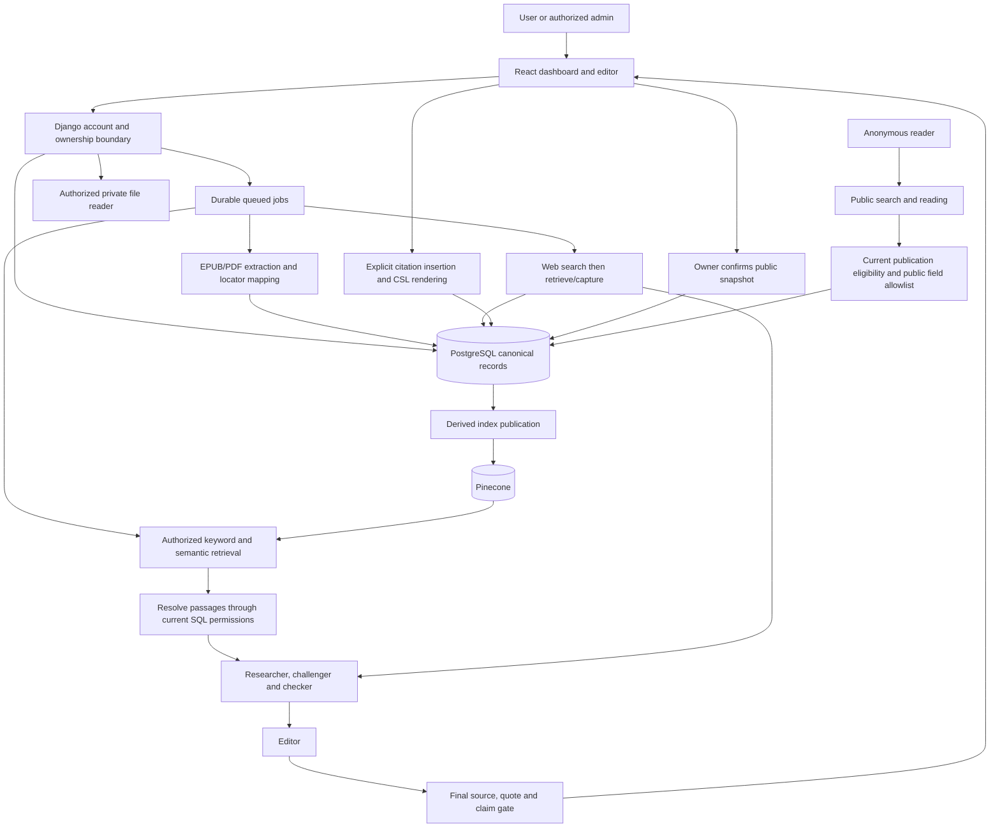

# Proposed architecture

Baseline v1 accepted November 3, 2026. **DESIGN ACCEPTED — not implemented, compatibility not verified.** Decisions are in [DECISIONS.md](DECISIONS.md); evidence is governed by [VALIDATION_POLICY.md](VALIDATION_POLICY.md). Detailed phase-specific configuration choices remain open.

## Baseline and missing components

D00's accepted design selects Django/Python, React/Tiptap, PostgreSQL and Pinecone. D23 uses one modular Django backend with separately running workers; exact package/API versions and service compatibility still require evidence. Accounts, essays, sources and research share that application, with the five agent roles as bounded stages. No additional web backend or independently deployed research service is selected.

Accepted D24 requires Ask/Review jobs to survive closing/leaving the page and save progress/results for an authorized return, until finished or explicitly cancelled. Accepted D25 sets an initial audience of personal use or roughly 25 invited writers. Neither establishes measured simultaneous-job capacity or public-reader load; D17/P13 must define and test those separately. The diagram is still a design, not a running deployment. Django supports feature packages within a project; its task framework requires a separate worker implementation. [Django applications](https://docs.djangoproject.com/en/6.0/ref/applications/), [Django background tasks](https://docs.djangoproject.com/en/6.0/topics/tasks/).

Latest D08/D17 scope is **local development with no paid services**. Use real local app/database/workers/object storage/mail capture, plus permitted confirmed free cloud integrations where needed. Hosting and internet launch are deferred. [LOCAL_DEVELOPMENT.md](LOCAL_DEVELOPMENT.md) records researched free candidates, limits, privacy and verification boundaries; none is enabled by this plan. The accuracy requirements remain unchanged.

| Component | Authority |
|---|---|
| React + accepted Tiptap OSS core | Presents/edits authorized structured essays and custom citations/review decorations; supplies no trusted ownership/role decision |
| Django + DRF candidate | Authenticates accounts, enforces lifecycle/permissions, validates writes and orchestrates tools/jobs |
| PostgreSQL | Authoritative accounts, ownership, source/passages, essays/revisions, citations, runs, evaluation and audit |
| Pinecone | Derived search data keyed to canonical passage/source versions; rebuildable from authorized originals/passages |
| Private object storage | Real local S3-compatible service for original assets/artifacts/captures; remote provider deferred; all delivery authorized |
| Durable queue/worker | Executes bounded jobs with trusted actor/owner context, retries, cancellation, progress and usage records |
| Email delivery | Local SMTP capture exercises approved message/activation flow; external mailbox delivery is future P14 evidence |
| CSL renderer | Produces citation/bibliography output from known metadata; model text is not the formatter |
| Search/model providers | External processors behind server adapters; no browser-held keys or authority to modify accounts/documents |
| Public publication/search | Serves only author-published snapshots and approved metadata; never a route into private drafts, profiles, research or libraries |

## Accounts and permissions

Normal users access only their own private profiles, drafts/revisions, sources/assets/passages, citations, research/review runs, progress, usage and exports. They and anonymous visitors may also read explicitly published essay snapshots. Admins manage/suspend users and view all essays/research/profiles; D02 denies editing/deleting other authors' writing. Accepted D06 limits admin evidence inspection to attachments and saved bounded context in those essays/results; it grants no private-library browsing, original-file reading/downloads or arbitrary neighboring passages. New research in another user's library remains undecided and denied. Initial admin login is password-only under D05. No public access is inherited from the old app.

Use named application permissions/groups plus owner/library checks. Django staff/admin-site flags are not a substitute for the product's role contract. Assign owner IDs from the authenticated server context, validate nested references, filter list/search/count endpoints, and recheck custom lookups. DRF object permissions alone do not cover list/create behavior. [DRF permission limitations](https://www.django-rest-framework.org/api-guide/permissions/#limitations-of-object-level-permissions).

Prefer same-origin session cookies and explicit CSRF protection, including login, unless D04 changes authentication. Reject client attempts to set roles, approval state, ownership or validation outcomes.

Lifecycle: `pending approval` → `approved awaiting activation/password completion` → `active`, with rejected/suspended states that cannot access the private app. Admin approval records an email-outbox task; a purpose-specific expiring token leads directly to mandatory initial password setup. No private document/profile/library/result/job access is allowed until the password is saved. Accepted D04 requires one initial setup step, followed by normal password login. Tokens authorize only the credential-completion operation, not a normal workspace session. No plaintext password is emailed.

A link GET should not activate an account merely because an email scanner fetched it. Password/activation submission rechecks approval and atomically consumes the grant. Failed email or incomplete/failed password submission leaves private access disabled. If a restricted intermediate credential state is needed, it permits only the dedicated password completion/logout paths, not ordinary authenticated APIs. Administrative forced password resets must use the same server-side access gate.

Check account state and current permissions on requests, job execution, result delivery and source resolution. Keep acting admin and content owner separate. Admin evidence inspection resolves through a permitted essay/research attachment and its saved context; changing passage IDs or paging through neighboring chunks cannot expand that grant. If later authorized, cross-owner admin research must use an explicit subject/library scope; until then it is denied. Sensitive owner original-file delivery must respect the agreed revocation policy; direct signed links need an explicit expiry/revocation design.

## Canonical records

| Record group | Important design rules |
|---|---|
| Account/profile/approval | Custom user model decision before first migration; hashed credentials; explicit approval/activation/audit states |
| Library/access scope | Private libraries only under D03; D06 denies general admin original/library access, permits only attached evidence inspection; no cross-user shared collection |
| Bibliographic work and private copy | CSL metadata and identifiers can describe the work; private assets/annotations retain their owner and independent lifecycle |
| Source version/asset | Immutable bytes/capture identity, edition/translation, extraction config, confirmed metadata, visibility and processing state |
| Passage/locator | Original text and normalized-search mapping; PDF printed label plus physical index; EPUB chapter/section/internal anchor; surrounding context |
| Essay/revision | Structured editor JSON is authoritative; stable node IDs; recoverable revisions and optimistic concurrency |
| Published snapshot | Explicit owner-confirmed saved revision, approved public byline/metadata and bibliography; separate public eligibility, visibility generation and withdrawal audit |
| Citation occurrence | Bound to essay/revision/source version/passage and intended support relationship; relational index derived from document in a transaction |
| Research/verification run | Question/context revision, permitted scopes, actual inspected evidence, bounded role outputs, checks, policy/model versions, usage and outcome |
| Essay review | Correctable claim ledger, thesis/premise/inference links, individual verdicts, critical dependencies, score inputs and stale status |
| Job/outbox/audit | Trusted actor/subject IDs, lifecycle, idempotency, attempts/deadlines/cancellation, delivery/usage outcomes; no credentials or raw private bodies in routine logs |

Deduplicate within an authorized library/source-version scope. A global ISBN/hash match must not reveal another person's holdings, merge their mutable metadata, or cause cross-owner deletion. Preserve source corrections as new versions; do not silently change a quotation already used in an essay.

## Ingestion and indexing

Proposed stages: uploaded → extracting → metadata/locator review → indexing → visibility checked → ready. Failed, cancelled and needs-attention outcomes are explicit. Preserve original assets; proposed extraction tool Docling requires representative EPUB/PDF testing. The known Great Courses example has usable printed labels, front-matter offsets and caption/layout complications; it remains a test candidate, not a completed ingestion.

Use deterministic passage/version IDs and an owner-scoped import manifest. Keep a prior accepted source generation active while a replacement is staged. An idempotent retry must not create duplicate citations or expose partial generations.

Pinecone namespaces are selected by the server for the permitted library. Never trust a browser-supplied namespace or arbitrary filter. Current documentation distinguishes document and vector-record indexes; choose API/index type, embedding model/dimensions and schema through D11/P08 compatibility checks. [Data modeling](https://docs.pinecone.io/guides/index-data/data-modeling), [multitenancy](https://docs.pinecone.io/guides/index-data/implement-multitenancy).

Pinecone writes are eventually consistent. An upload acknowledgement is insufficient for “searchable”: verify visibility with the chosen API's documented mechanism and bounded polling. Reindex safely and reconcile remote/orphaned records. PostgreSQL revocation blocks passage use immediately at resolution even while remote deletion is pending. [Data freshness](https://docs.pinecone.io/guides/index-data/check-data-freshness).

Combine exact/keyword retrieval with semantic retrieval and optional reranking. Retrieve surrounding context after matching. An authorized vector hit is a search candidate, not evidence of truth. Resolve its canonical text and current permissions in PostgreSQL before sending anything to a model or popup.

## Ask: answer the user's question

Input is a free question plus optional selected essay context. Web/My library/Both scopes are explicit. A library question can search an authorized EPUB/PDF collection and public web sources without mixing their identities.

Accepted D17 uses thorough initial research with an option to investigate further, within limits still to be agreed. Both source selection and contrary-evidence searches remain in scope. Further investigation is bounded and must pass the same current-authorization and final-output gates; it may change the answer rather than merely add supporting links.

| Role | Job | Authority boundary |
|---|---|---|
| Researcher | Retrieve relevant original passages and propose an evidence-bounded answer | Read-only permitted sources; cannot invent registry IDs |
| Challenger | Independently seek exceptions, counterevidence, corrections and source dependence, then challenge proposed claims | Must supply actual evidence; disagreement is not proof |
| Checker | Code checks source/locator/quote/permissions/numbers; a distinct evidence-conditioned assessment checks meaning and scope | Mechanical pass is separate from semantic support |
| Editor | Compose the answer from admissible findings, preserving uncertainty and disagreement | Cannot create a verified status or silently edit the essay |
| Final validator | Recheck the actual final factual clauses, quote spans and citation coverage after editing | Blocks unchecked additions; bounded repair returns through this gate |

These are bounded orchestration roles, not five autonomous services with unrestricted tools. Shared models and agreeing agents are not independent proof. Model/provider selection and budgets remain D07/D17.

Until checks and the P10 quality gate qualify the configuration, no ready-to-cite verified label is enabled for normal users. Stream progress, not unchecked factual answers. Return explicit unresolved results when research fails. Source cards distinguish support, qualification, contradiction and background; inspected originals and context are available for either side. Citation insertion is an explicit undoable user action using known source records.

Accepted D15 requires two independent human reviews per test example, initial science/politics/religion/philosophy coverage and a conservative uncertainty-adjusted lower estimate of accepted-pair precision >=80%. Actual reviewers, sample counts, interval method/confidence level, adjudication and coverage/stopping rules remain to be agreed before testing. This is not an individual citation's truth probability. Accepted fabrication/authorization failures block independently of the aggregate score. Essay Review still needs its separate claim/argument evaluation.

## Essay Review: evaluate the user's draft

Input is an immutable essay revision, including partial drafts. Reconstruct a correctable claim/argument map, verify cited and uncited factual assertions, then examine whether premises justify the conclusion. Preserve qualifiers, negation, definitions and relevant paragraph context during decomposition.

Accepted D16 requires fully supported distinct factual claims / all detected distinct factual claims in the corrected scope ledger, with a separate conclusion assessment. Pending/unresolved/skipped facts stay in the denominator; opinions/values stay outside it. Show review completion and provisional/incomplete detection; unknown is not false, completed zero-fact detection is N/A and unfinished detection is Incomplete. Use Supported / Partly supported / Disputed / Contradicted / Insufficient evidence / Cannot assess, with workflow/stale status separate. Critical unsupported premises/inferences keep the conclusion flagged despite supported background; normative conclusions receive conditional reasoning assessment. Exact rubric and coverage thresholds remain open.

A separate P11 benchmark is required for claim extraction, inference judgments and score/report behavior. Ask's citation precision does not demonstrate essay-review accuracy. Edits invalidate affected claim findings and dependent conclusions, even where conclusion wording did not change.

## Writing workspace and document formats

Accepted D14 selects a calm editor with a collapsible/resizable Ask/Sources/Review side panel, using the Quiet Study / Research Desk direction. Panel layout changes retain the draft, caret and research state; mobile/keyboard details and final visual acceptance remain P05 work.

Accepted D26 adds toggleable inline review highlights linked both ways to panel findings and evidence. Keep revision-bound anchors and stale status; hiding highlights changes display only, not findings or source verdicts. Derived review decorations are separate from authored text, bibliography and default public/export content. Edits must never leave a verified-looking highlight on changed/unrelated text.

Accepted D10 selects the free MIT Tiptap core with custom citation nodes/decorations and our own backend revisions/research/export services. Paid platform offerings are not dependencies of the $0 design. Verify package/extension licensing, schema persistence and runtime compatibility in P02/P05. [Tiptap OSS](https://tiptap.dev/open-source-to-platform), [custom nodes](https://tiptap.dev/docs/editor/extensions/custom-extensions/create-new/node).

Accepted D13 requires DOCX, PDF and a portable structured backup in the first release. MLA is the default, with APA and Chicago selectable per essay. One selected document style handles its books, EPUB/PDF/course material and web references; changing styles changes rendering rather than source identity or verification status. Select the exact CSL versions/Chicago variant and export engines through P02/P06 compatibility work. Validate text and citation fidelity; do not promise exact Word pagination, Word citation-manager fields or DOCX import/edit round-tripping. The portable backup preserves structured document/citation/source records under a defined schema and access policy.

## Private drafts and public reading

Accepted D01 adds owner-controlled publication and unauthenticated public search/read. Drafts remain private. Publish captures an explicitly previewed saved revision; subsequent private edits require an explicit Update publication before becoming public. Withdrawal removes app-controlled public access; the app cannot guarantee erasing readers' copies or external caches.

Use a separate public serializer/search corpus containing only eligible snapshots and D21-approved fields. Accepted D21 includes the essay and bibliography for every actually cited source type, including ingested PDFs/EPUBs, plus available public links; it excludes extra private chunks, originals, passage popovers, research IDs, profiles and private review history. Format references from original-source metadata and genuine locators using the essay's CSL style, not a chunk identifier. Existing quotations intentionally included in published prose remain visible as authored prose. Byline identity and search-engine indexing remain open D21 choices.

Recheck publication eligibility on read/search delivery even when an index/cache is stale. Accepted D22 leaves existing published essays public/readable/searchable when an account is suspended; private access and new owner actions/jobs are blocked. Do not implement public eligibility as simply author-is-active. Suspension preserves content and does not grant editing/deletion or author impersonation. Reinstatement does not republish withdrawn snapshots. Whether any review report is publicly displayed requires an explicit D16/D21 decision; publication itself is not factual certification.

## Supporting operations

### Rebuild location, original-file storage and scan scope

Revised D08 (round 13) builds the new application at this repository's root. P01 moves the legacy Laravel tree into `retired/` with `git mv`, keeping its history, and D27 drops the legacy MySQL database without a fresh dump. D18 imports no legacy data, so the data model has no legacy mapping/import records. New tooling excludes `retired/`. The new app uses its own PostgreSQL database and storage. Accepted D28 runs PostgreSQL, the S3-compatible store, mail capture and the queue broker as one Docker Compose project (`athenaeum`), created in P02. D27 drops only `journeyman` from the native MySQL server; the server and its other databases remain. Current application execution is local; hosting is deferred rather than an immediate prerequisite.

Accepted D09 uses private object storage for original EPUB/PDF assets, separate from PostgreSQL records and Pinecone's search index. In the free local profile, select a real local S3-compatible implementation in P02; no remote vendor/account/region is selected. App/worker access does not grant product users cross-owner access or admins library browsing. Later remote-provider behavior, backups/retention/versioning and authorized delivery need specific design and proof. [Object storage and access controls](https://docs.aws.amazon.com/AmazonS3/latest/userguide/Welcome.html).

Accepted D12 excludes OCR ingestion from the first release: support EPUBs and selectable-text PDFs, detect scans and disclose unsupported/missing text. A per-page coverage manifest must distinguish blank/decorative content, extracted text and unknown/substantive image-only pages; a cover/footer text layer alone cannot establish completeness. Preserve partial output for inspection in needs-attention state and block automatic indexing/readiness unless a later explicit partial-index policy is approved. Research cannot infer a whole document lacks evidence when some content was not searched. Docling has OCR options for future scope, not an enabled first-release feature. [Docling OCR](https://docling-project.github.io/docling/concepts/OCR/).

Round 9 supersedes immediate hosting selection: no hosted deployment or paid usage now. The accepted backup recovery-point target is at most about one hour of saved changes, but round 10 reports no existing independent backup destination. Define failure scope/destination and demonstrate a fresh consistent database/object restore before claiming protection. Same-device copies do not establish whole-device-loss recovery; that target remains unverified, not reduced. Actual restore time/retention remain open; hosted recovery qualification belongs to future P14.

### Cloud processing — accepted direction, provider settings still open

Think of the library as a private bookshelf and a cloud AI as a helper working at another company's office. Choosing My library selects the bookshelf; it does not determine where the helper works. Cloud processing sends approved text to that office for a task. It does not publish the text on the public essay website, but the outside provider does receive it.

| Action | Possible external data under a cloud design | Purpose |
|---|---|---|
| Index a book/PDF | Every indexed passage may reach an embedding provider in batches; Pinecone may receive vectors, IDs, permitted metadata and possibly text depending on the chosen mode | Make related passages searchable |
| Ask | Question, necessary selected draft context and retrieved passages | Answer and check the question against sources |
| Web discovery | A minimized approved search query | Find public sources; no automatic full-draft/book upload to search |
| Essay Review | Needed sections or the current draft plus relevant evidence | Identify/check claims and their context |

A privately run model could keep model processing on a computer/server we control, with its own setup and compute requirements. The user has accepted selected outside AI services after this explanation, so private model hosting is an alternative rather than a requirement. D07 still selects actual recipients, per-task data and retention/training settings; no particular provider policy or deletion guarantee is assumed. External vector storage contents remain a separate configuration decision, and vectors must not be treated as anonymized text. This design acceptance does not authorize live processing during the planning-only task.

After the reuse explanation, D07 also permits training/product-improvement reuse where applicable terms permit. It does not waive provider input restrictions or grant arbitrary sharing/public application access. Select an eligible provider/data profile, record its policy/configuration in run provenance and accurately disclose processing/reuse to future users. No optional account setting is changed or required merely because reuse is allowed; retaining provider defaults remains possible. Privacy eligibility, retention/access review, $0 limits and research qualification stay separate checks.

Django Tasks defines/enqueues work but does not provide production execution workers. Select a durable execution backend, outbox/retry behavior and deployment topology in D09. [Django Tasks](https://docs.djangoproject.com/en/6.1/topics/tasks/).

Use polling for progress as a candidate baseline. Persist run ID, revision, owner/actor, progress and output independently of the browser. Closing the page is not cancellation; authenticated return reopens the same permitted run without duplicate active work/replayed committed output. Workers use account/source authorization, not browser cookies. On the development computer, sleep/shutdown can pause processing and requires recovery. Accepted D17 quota exhaustion persists a visible waiting state and resumes when free quota is available, using provider reset information when known and bounded retry/deadline rules. Resume rechecks cancellation, current permissions and input/source staleness. Ambiguous external outcomes remain recorded; no exactly-once guarantee, paid fallback or automatic upgrade is implied.

Private uploads and fetched pages are untrusted input. Validate file types/sizes and extraction limits; prevent unsafe URL schemes/private-network fetches; sanitize rendered captures/editor output. Source instructions cannot change roles, scores, prompts, permissions or write tools. Keep keys server-side.

Free-provider settings, runtime/local-service choices, quota limits, backup destination/failure scope, deletion/retention and remaining publication metadata are open design details. Hosting stays deferred. Optional publication, essay+bibliography scope and continued public reading after suspension remain accepted product behavior, tested locally first. No private material was sent to research/model providers in this planning task.
