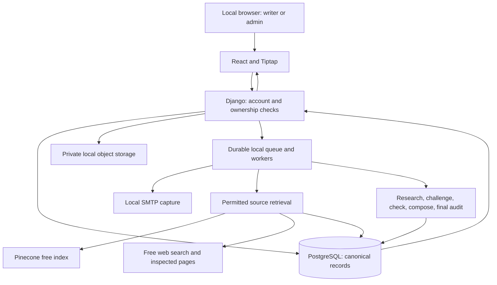

# Accepted local architecture baseline v1

Accepted November 3, 2026. **DESIGN BASELINE v1 · NOT IMPLEMENTED · NOT QUALIFIED.**

**Amendment v1.1, November 3 (round 13, user-directed):** build in this repository with legacy files moved to `retired/` (revised D08); start empty with no legacy import (D18); drop the legacy MySQL database without a fresh dump while keeping PostgreSQL for the new app (D27). The impact review is in [DECISIONS.md](DECISIONS.md#thirteenth-round-answers--november-3-2026-post-acceptance-amendment). Nothing else in the baseline changes.

The user accepted this consolidation of the interview choices as a planning baseline only. It does not authorize application code, installation, repository creation, account changes, paid usage or deployment. Exact implementation/evaluation details are decided at the named phase gates below; material architecture changes require a recorded impact review.

## The application we are designing

A local writing/research application for eventual personal use or roughly 25 invited writers. Build at this repository's root after moving the legacy project into `retired/`, keeping its Git history; the legacy MySQL database is dropped and no legacy data is imported. Hosting and internet launch are deferred. Current development uses local services and confirmed free tiers only.

The accepted D00 stack combines React/Tiptap, Django, PostgreSQL and Pinecone. Exact versions, service configurations, free-tier suitability and compatibility remain future evidence gates; design acceptance is not evidence that they run together.

| Component | Responsibility and boundary |
|---|---|
| React + Tiptap's free open-source core | Calm writing canvas, collapsible/resizable Ask/Sources/Review panel, custom citation nodes and toggleable review highlights; no paid Tiptap dependencies |
| One modular Django backend | Accounts, permissions, essays, sources, research orchestration and server-owned validation results |
| Local PostgreSQL | Authoritative accounts/ownership, structured essay revisions, source metadata and canonical passages, citation records, jobs, findings and audit |
| Local durable workers and queue | Ingestion/research/review/email work with saved progress, bounded attempts and current permissions; five AI roles are stages, not five services |
| Real local S3-compatible object storage | Original EPUB/PDF files, immutable source assets and captures; private authorized delivery |
| Local SMTP capture | Real approval-email/password-setup journey without sending to external inboxes; hosted deliverability remains unverified |
| Pinecone free-tier target | Rebuildable external vector index; never the authoritative copy of passage text, ownership or source evidence |
| Approved free web/model services | Search, inspect public sources and process permitted context; exact providers/models/privacy settings and quality remain to verify |

The Tiptap core is free/MIT; our own backend supplies revisions, research and exports rather than paid platform features. [Official OSS scope](https://tiptap.dev/open-source-to-platform).

Actual versions, local service engines, API contracts and performance still need compatibility/integration evidence. A diagram or command found on the computer is not that evidence.

## Accounts, private work and publication

- Registration → pending approval → admin approval and email → mandatory initial password setup → active account. Private UI/API/job access stays blocked until the password is saved; merely opening a link does not activate it.
- Regular users access only their own private information. Owners come from trusted server context, and nested IDs, lists/counts, files, jobs, exports and caches enforce the same boundary.
- Admins manage/suspend accounts and inspect all essays, research results and profiles; they cannot edit/delete another author's writing. Admin login is password-only initially.
- Admin evidence inspection is limited to attached passages and saved bounded context. No entire-library/original-file browsing/downloads or new cross-owner research is granted. Operational service credentials are not app-admin permissions.
- Drafts start private. An author explicitly publishes a saved snapshot; later draft edits require an explicit publication update. Locally test anonymous search/read of eligible snapshots, without exposing private drafts, profiles, libraries or research history.
- Suspension blocks private access and new owner actions/jobs but leaves existing published essays readable/searchable. Withdrawal is a separate owner action; reinstatement does not republish withdrawn work.

## Sources and citations

Ingest EPUBs and selectable-text PDFs; no first-release OCR. Preserve originals, edition/translation and source versions. Use real PDF printed/physical page distinctions and EPUB chapter/section anchors, never invented pages. Course-guide commentary is attributed to its lecturer/guide rather than the philosopher it describes.

Detect unsupported scans and substantive missing/image-only pages. Preserve incomplete extraction for inspection, flag needs-attention and do not automatically index it. A vector match is only a candidate: resolve canonical passage text, active source/readiness and current permissions in PostgreSQL before model context or a popup.

Citation insertion is deliberate and undoable. Offer suitable choices only when they exist, with supporting/opposing source inspection and actual links or private passage/context views. One essay style formats its books, EPUB/PDF/course material and web references: MLA by default, with APA/Chicago selectable. Include every actually cited source in the bibliography. Required outputs are DOCX, PDF and a structured portable backup; exact Word pagination/import or Word citation-manager fields are not promised.

## Ask and Essay Review are different workflows

**Ask checks the assistant's answer.** A question plus optional selected text uses explicit Web / My library / Both scope. My library makes no web-discovery calls; Web retrieves no library passages. Thorough research is the default, with further investigation available under limits.

Researcher retrieves permitted evidence → Challenger seeks meaningful exceptions/counterevidence → Checker runs code-based identity/quote/permission checks and evidence-conditioned support assessment → Editor composes → Final validator audits the actual final clauses/citations. These are bounded roles, not a vote. Source text cannot grant tools or permissions. Show progress, not unchecked prose as a verified answer.

**Essay Review checks the user's saved revision.** Build a correctable distinct-fact/argument ledger, check existing citations and uncited facts, research support/opposition and examine whether premises justify the main conclusion. Source/claim edits stale affected findings and dependent conclusions.

`Factual support = fully supported distinct factual claims / all detected distinct factual claims × 100`

Pending/unresolved/skipped factual claims stay in the denominator; opinions/values are outside it. Six supported + two contradicted + two unreviewed means **60% supported so far, 8/10 reviewed**, provisional. Review completion is not truth probability. Completed detection with zero factual claims yields **Not applicable**; incomplete detection is **Incomplete**, not evidence that no factual claims exist.

Show a separate conclusion assessment: supported background cannot average away an unsupported critical premise/inference. Individual claims use **Supported, Partly supported, Disputed, Contradicted, Insufficient evidence, Cannot assess**. Missing evidence is not false. Pending/Paused/Cancelled/Stale are separate workflow/currentness states. Detailed grading and minimum review coverage remain phase decisions.

Toggleable inline highlights link both ways to findings/evidence in the Review panel. Hiding highlights preserves findings, draft and caret. Edited/deleted spans cannot retain current supported styling or jump to unrelated text. Private review decorations are not authored prose or automatically public/exported findings.

## Quality, free limits, privacy and recovery

- Only vetted Ask results are normal ready-to-cite options. An accepted essay-score presentation also requires its separate qualification gate. Manual text/references and developer fixtures cannot create machine-verified status.
- Qualification uses two independent human reviews per example across science/politics/religion/philosophy and relevant EPUB/course-PDF/web cases. The conservative uncertainty-adjusted lower estimate of accepted-pair precision must reach 80%; observed percentage alone is insufficient. Exact samples, confidence method/level, adjudication, coverage and stopping rules are still required. This is not a per-citation truth guarantee. Essay Review needs its own human claim/argument benchmark.
- No paid calls, upgrades, paid fallback or expiring paid trial dependencies. Free-quota exhaustion pauses the same saved job; resume checks quota, cancellation, deadlines, current access and input/source staleness. Unknown reset times are not invented. No free model or service has passed qualification yet.
- Closing the browser does not cancel work. The development computer/services must be running; sleep/shutdown can pause processing, with durable recovery required on restart.
- Selected outside services may process required text and reuse it for training/product improvement where applicable terms permit. Input restrictions, necessary-data scope, retention, human access and accurate future-user disclosure still require separate checks. This changes no app ownership/publication rule and enables no provider/account now.
- The target is at most roughly one hour of lost saved changes after a serious failure. There is currently no independent backup destination, so whole-device/disk-loss recovery remains unverified. Same-Mac copies and surviving vectors are not sufficient. Keep the target; choose failure scope/destination and prove consistent PostgreSQL/original-asset restore before claiming it.

## Phase gates and decisions deliberately left for later

| Gate | Decisions/evidence required before that work can pass |
|---|---|
| P01 retirement | Exact legacy database identity, disposal record and execution-time drop confirmation |
| P02 foundation | Pinned runtimes/free extension licenses, local worker/queue/object-store/mail implementations, export compatibility and no-paid preflights |
| P03 accounts | First-admin bootstrap, promotion/demotion/recovery/reactivation rules and tested local SMTP/session/ownership behavior |
| P04 evidence/evaluation | Actual reviewers/authorized fixtures; exact samples, source/claim grouping, statistical method/confidence level, grading, adjudication, minimum coverage and stopping rules |
| P05/P06 writing/citations | Final visual/mobile/keyboard checks, CSL versions/Chicago variant, export engines and portable-backup schema/restore/retention |
| P07–P10 ingestion/research | Numeric file limits, actual source fidelity, Pinecone API/index/embedding compatibility, provider data profiles and bounded search/retry/deadline/concurrency limits; real free integrations and Ask qualification |
| P11 essay review | Detailed argument/claim rubric, critical-dependency and stale-highlight behavior, separate human benchmark and score validity |
| P12 local publication | Public byline/allowed metadata, any explicit public review report and withdrawal behavior; anonymous local privacy tests |
| P13 local acceptance | All applicable prior gates, actual integrated local/free workflow, scope-specific one-hour restore evidence and user walkthrough |
| P14 future/deferred | A later launch decision, hosting/budget, external email/storage/HTTPS/capacity and affected quality qualification, approved deployment and recovery; whether local-app content carries into the launch |

Every applicable current-phase criterion needs evidence, independent review and user acceptance before dependent work advances. Unavailable free services, missing backups or failed benchmarks remain unverified. Hosted requirements are explicitly deferred, never marked passed by a local test. Accepting this design moves no file and drops no table; that happens only in authorized P01 work.

## Traceability to the user's confirmed requirements

| Requirement | Main acceptance cases |
|---|---|
| R01 planning-only/co-design | P00-AC08, P00-AC11; status and interview records |
| R02 in-place retirement | P01-AC03, P01-AC05, P01-AC07, P01-AC08, P01-AC10 |
| R03 admin management/inspection | P03-AC07, P05-AC03, P06-AC16 |
| R04 private ownership/public exception | P03-AC06, P08-AC02, P12-AC01, P12-AC05 |
| R05 approval/email/password gate | P03-AC02, P03-AC03, P03-AC04, P03-AC11 |
| R06 dashboard/new/edit/resume | P05-AC01, P05-AC05, P05-AC06, P05-AC07 |
| R07 ergonomic writing/research UI | P05-AC13, P05-AC14, P05-AC19, P11-AC17 |
| R08 private EPUB/PDF plus web | P07-AC04, P07-AC05, P07-AC07, P09-AC10 |
| R09 evidence-backed Ask/counterresearch | P10-AC02, P10-AC04, P10-AC05, P10-AC08 |
| R10 vetted choices/explicit insertion | P06-AC03, P10-AC07, P10-AC08, P10-AC09 |
| R11 factual/argument review and score | P11-AC02, P11-AC06, P11-AC09, P11-AC10, P11-AC15 |
| R12 bounded research/checking roles | P10-AC01, P10-AC05, P10-AC06 |
| R13 measured quality floor | P04-AC07, P04-AC08, P04-AC09, P10-AC11, P13-AC05 |
| R14 verified incremental progression | P00-AC07, P13-AC14 and each phase's evidence/exit record |

Phase links and the sequence are in [REBUILD_PLAN.md](../../REBUILD_PLAN.md). Detailed decisions, evidence limits and operating profile are in [DECISIONS.md](DECISIONS.md), [VALIDATION_POLICY.md](VALIDATION_POLICY.md) and [LOCAL_DEVELOPMENT.md](LOCAL_DEVELOPMENT.md).

**Review disposition: accepted by the user November 3, 2026; amended by round 13 the same day. P00 design is complete; all application implementation/qualification remains NOT STARTED / NOT VERIFIED.**
